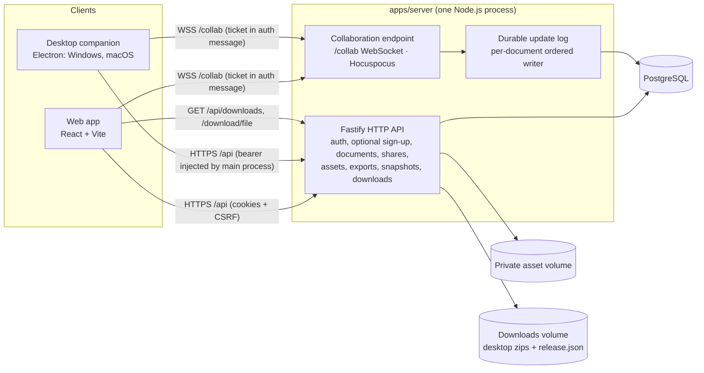
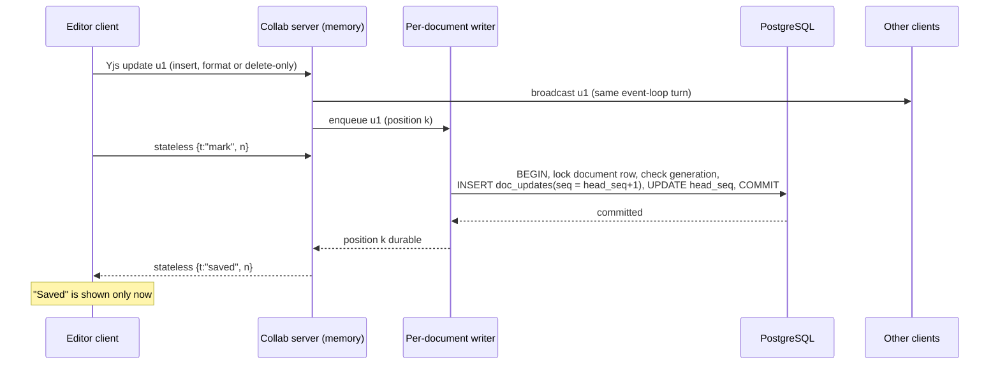
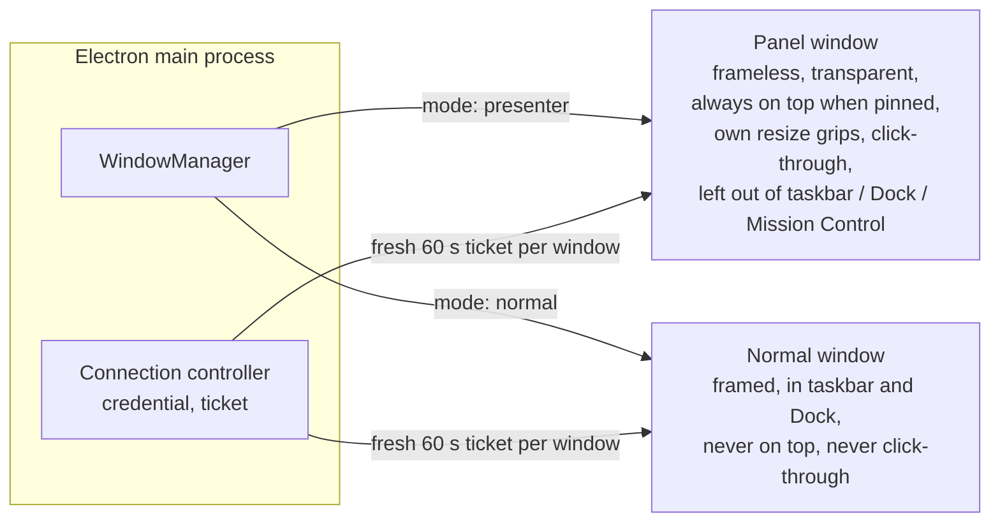
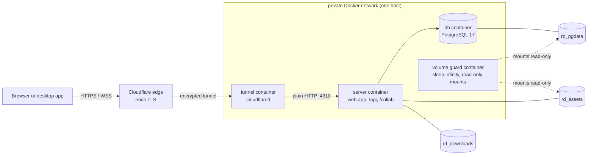

# RealtimeDocs architecture

This document is the binding design for the codebase. Code that deviates from it must update it.

## 1. System overview

| Path                      | Responsibility                                                                                                                                                                                                                                     |
| ------------------------- | -------------------------------------------------------------------------------------------------------------------------------------------------------------------------------------------------------------------------------------------------- |
| `packages/contracts`      | Runtime-validated API contracts (zod), roles, error codes, collaboration side-channel messages, link formats, schema/protocol versions, typed API client.                                                                                          |
| `packages/editor`         | Authoritative document schema (`src/schema`, DOM-free), exporters (`src/export`, DOM-free), Tiptap extensions and node views, clipboard/upload pipeline, collaboration session (`src/collab`), React editor components. Shared by web and desktop. |
| `packages/ui`             | Design tokens and accessible React controls.                                                                                                                                                                                                       |
| `apps/server`             | Fastify API, Hocuspocus collaboration, durable log, storage adapter, migrations, CLI commands, optional sign-up, desktop download endpoints.                                                                                                       |
| `apps/web`                | Dashboard, editor, share-link viewer, invitations, settings, print view.                                                                                                                                                                           |
| `apps/desktop`            | Electron main process (windows, tray, shortcuts, capture protection, credentials, Privacy Test Center records), preload bridge, packaged renderer, optional Windows diagnostics module (`native/win-display-affinity`).                            |
| `tests/e2e`, `tests/perf` | Playwright acceptance tests and the latency harness.                                                                                                                                                                                               |

One backend deployment and **one collaboration instance** own all documents. See §10 for what horizontal scaling would require.

## 2. Data model (PostgreSQL)

All identifiers are random UUIDv4 (opaque). Every table that belongs to a workspace carries `workspace_id`; every query filters by it even though the initial deployment has a single workspace.

| Table              | Purpose                                                                                                                                                                                                                                                                                                                                                            |
| ------------------ | ------------------------------------------------------------------------------------------------------------------------------------------------------------------------------------------------------------------------------------------------------------------------------------------------------------------------------------------------------------------ |
| `workspaces`       | Tenant boundary.                                                                                                                                                                                                                                                                                                                                                   |
| `users`            | Accounts: email (unique per workspace, case-insensitive), display name, Argon2id password hash, workspace role (`admin`/`member`), status.                                                                                                                                                                                                                         |
| `sessions`         | Hashed session tokens. `kind`: `user` (browser), `share` (guest of one share grant), `desktop` (document-scoped companion session). Columns bind a session to `user_id` or `share_grant_id`, to a `document_id` scope (share/desktop), and to a `parent_session_id` (desktop sessions derived from a browser session). `expires_at`, `last_seen_at`, `revoked_at`. |
| `invitations`      | Account invitations (hashed secret, optional email, workspace role, expiry, accepted/revoked). Never grant document access by themselves.                                                                                                                                                                                                                          |
| `documents`        | Title, status (`active`/`archived`/`trashed`), `generation`, `schema_version` (2 since the `callout` block was added), `head_seq` (last committed update sequence of the current generation), timestamps.                                                                                                                                                          |
| `document_members` | Per-document grant for an account: `editor` or `viewer`.                                                                                                                                                                                                                                                                                                           |
| `share_grants`     | Document share links: role, SHA-256 hash of the secret, label, expiry, revocation, `rotated_from`.                                                                                                                                                                                                                                                                 |
| `doc_states`       | Compacted Yjs state per `(document_id, generation)` with `upto_seq`: the state contains every update with `seq <= upto_seq`.                                                                                                                                                                                                                                       |
| `doc_updates`      | Append-only Yjs update log: `(document_id, generation, seq)` primary key, `update bytea`.                                                                                                                                                                                                                                                                          |
| `snapshots`        | Named and automatic `pre_restore` snapshots: full Yjs state + generation taken from.                                                                                                                                                                                                                                                                               |
| `assets`           | Uploaded files: document, kind, randomized storage key, sanitized name, verified MIME type, size, dimensions, SHA-256, status, `unreferenced_since`.                                                                                                                                                                                                               |
| `desktop_handoffs` | Single-use, 60-second handoff codes (hashed) bound to a principal and a document.                                                                                                                                                                                                                                                                                  |
| `audit_events`     | Administrative and security events. Never document content, passwords, secrets or tokens.                                                                                                                                                                                                                                                                          |

## 3. Authentication, sessions and authorization

- **Passwords**: Argon2id through Node's built-in `crypto.argon2` (memory 64 MiB, 3 passes, parallelism 1), per-password random salt, constant-time comparison, minimum length 12. The first administrator is created by a local CLI (`pnpm bootstrap:admin`), which refuses to run once any account exists. No default credentials exist.
- **Session tokens**: 32 random bytes (base64url). Only the SHA-256 hash is stored. Browser sessions use an `HttpOnly`, `SameSite=Lax` cookie (`Secure` whenever the public origin is HTTPS). Absolute and idle expiry are enforced on every request.
- **Share sessions**: exchanging a share link sets a separate `HttpOnly` cookie named `rd_share_<documentId>` with `Path=/api/documents/<documentId>`, so it is only ever sent to that document's endpoints and several shared documents can be open at once.
- **Desktop sessions**: bearer tokens scoped to one document, held only by the Electron main process.
- **CSRF**: unsafe methods require (a) an `Origin` on the allow-list, (b) the `X-RD-CSRF` header, which for account sessions must equal the per-session token (HMAC of the session id) and (c) are never honoured from cross-site contexts (`Sec-Fetch-Site`). Bearer-authenticated desktop requests do not use cookies and are exempt.
- **Authorization** is resolved per request by one function, `resolveAccess(principals, documentId)`:
  1. Collect principals: bearer desktop session, account session cookie, share cookie for that document.
  2. Verify each is unexpired, unrevoked, and that its account/grant is still active and belongs to the document's workspace.
  3. Role: workspace admin → `admin`; active membership → its role; active share grant → its role. Archived documents cap everyone at `viewer`; trashed documents are unreachable (`document_trashed`) except for admin lifecycle routes.
  4. The highest role wins and the response records _which_ grant produced it (`via`), so independent permissions stay independent: revoking a link does not affect a membership and vice versa.
- Every HTTP route, upload, download, export, snapshot operation and collaboration ticket goes through `resolveAccess`. Knowing an id grants nothing: unknown and unauthorized documents both answer `not_found` to non-members.
- **Rate limits** (in-memory, per instance): login per IP and per email, share exchange per IP and per grant, invitation lookup/accept, desktop redeem, collaboration tickets, uploads, WebSocket upgrades per IP, and sign-up per IP and per email.
- **Optional sign-up** (`ALLOW_SIGNUP`, off by default): `POST /api/auth/signup` creates a workspace `member` with a session exactly like accepting an invitation, and no document access. The first administrator is still created only by the local command. `GET /api/meta` publishes `signupEnabled` so the web app can show or hide the sign-up screen. See [security.md](security.md).

## 4. Share links, invitations and desktop handoff

- Share URL: `https://<host>/s/<grantId>#<secret>`. The secret (32 random bytes) lives only in the fragment: it is never sent in a request line, `Referer` (`Referrer-Policy: no-referrer`) or log. The web app reads it, **removes it from the address bar**, posts it in the body of `POST /api/share/exchange`, then replaces the route with `/d/<documentId>`.
- Links are view-only by default; edit links are an explicit administrator choice. Expiry, revocation and rotation are supported. Rotation revokes the old grant (and everything derived from it) and issues a new grant.
- The full URL is displayed once at creation/rotation; afterwards only metadata is available because only the hash is stored.
- **Revocation/expiry/downgrade enforcement**: every derived session row carries `share_grant_id`. Revoking marks the grant and its sessions revoked in one transaction, then the collaboration registry re-evaluates live connections of that document: connections whose access ended receive an `access` message and are closed; downgraded connections are switched to read-only in place. Expiry is enforced by a per-connection timer plus a periodic sweep. Asset, export and ticket requests fail on the next call. Revocation stops future access; it cannot erase content already received.
- **Invitations** create accounts (`/invite/<id>#<secret>`). They are a separate table, lifecycle and UI from share links.
- **Open in Desktop**: `POST /api/documents/:id/desktop-handoff` creates a 60-second single-use code bound to the caller's principal and the document; the browser navigates to `realtimedocs://open?server=<origin>&doc=<id>&code=<code>`. The desktop main process validates scheme, action, parameters and that `server` equals the configured server origin, then redeems the code for a document-scoped desktop session. **Paste Share Link** is the always-available alternative: the main process parses the link, checks the origin against the configured server and exchanges the secret in `bearer` mode.

## 5. Real-time collaboration

### 5.1 Transport and authentication

- Clients use `@hocuspocus/provider` against `WS(S) /collab`. The URL carries no credentials.
- Before each connection attempt the client calls `POST /api/documents/:id/collab-ticket` and puts the returned single-use, 60-second ticket in the Hocuspocus authentication message. `onAuthenticate` consumes the ticket, **re-resolves access from the database**, verifies the room name `"<documentId>.g<generation>"` against the current generation, checks schema/protocol compatibility and sets `readOnly` for viewers. The role is never taken from the client.
- The upgrade handler validates the `Origin` header against the allow-list (web origin(s) and `app://realtimedocs`), enforces a connection cap, a maximum frame size and a per-socket inbound message budget.

### 5.2 Server document lifecycle

- A document's Yjs state is created **exactly once**, inside the transaction that inserts the `documents` row (or a new generation), from ProseMirror JSON via the shared schema. Clients never initialize content, so reconnects and restarts cannot duplicate it.
- `onLoadDocument` rebuilds the in-memory document from `doc_states` plus all `doc_updates` with `seq > upto_seq` in order.
- View-only enforcement happens in the update-processing path: Hocuspocus refuses sync-step-2 and update frames from read-only connections, and the durable log additionally refuses to persist any update whose origin is a read-only connection (the document is unloaded and reloaded from storage if that ever happens).

### 5.3 Durable update log and acknowledgements

- Each loaded document has one `DurableLog`: an ordered in-memory queue and a single-flight writer. Updates are enqueued synchronously in the Yjs `update` event. The writer takes everything queued (group commit: a measured batch with no artificial delay), merges it with `Y.mergeUpdates` and commits it in one transaction that locks the `documents` row, verifies the generation and assigns the next `seq`. Sequence numbers are therefore gap-free and monotonic per generation, and an older write can never land after a newer one.
- **Acknowledgement** (see `packages/contracts/src/collab.ts`): the client counts its local Yjs transactions (`n`) and sends `mark n` after its updates. Hocuspocus processes each connection's frames strictly in order, so when the marker is handled every earlier update is already queued; the server replies `saved n` only when that queue position is committed. This covers deletion-only edits, which do not advance a state vector.
- **(Re)connect proof**: after the sync handshake the client sends `hello` with an encoded Yjs snapshot (state vector **and** delete set). The server replies `saved` only if its document contains all of it and everything is committed; otherwise `resync`. This is what makes "Saved" truthful for offline work and after a server restart.
- **Failures**: a failed commit keeps the batch at the head of the queue, sends `save-error` to waiting connections and retries with capped exponential backoff and jitter. `saved` is sent only after a later attempt commits. The queue is bounded (bytes); when it is full the document stops accepting edits (`persistence` message, connections temporarily read-only) and clients keep their work locally. Documents with uncommitted updates are never unloaded.
- **Compaction** runs inside the same writer: it encodes the in-memory state, records `upto_seq = head_seq` and deletes only log rows with `seq <= upto_seq` in one transaction. Rows beyond the boundary are untouched.
- Graceful shutdown flushes queues, but correctness never depends on it: anything not acknowledged is still held by the client and re-sent after reconnect.

### 5.4 Presence

Presence uses Hocuspocus awareness, separate from document state and never persisted. The `beforeHandleAwareness` hook keeps only the entry for the connection's own Yjs client id, replaces `user` with the authenticated identity, strips cursors from read-only connections, drops removals of other clients and applies a per-connection rate limit. Disconnects remove the participant.

### 5.5 Generations and snapshot restore

Restoring a snapshot (administrators only) creates a `pre_restore` snapshot, increments `documents.generation`, stores the snapshot as the new generation's base state with `head_seq = 0`, then notifies and closes all connections of the old room. Tickets, room names and log writes are generation-bound, so a client that was offline on the old generation is rejected (`generation_mismatch`), starts a fresh Yjs document for the new generation and keeps its unsent work as a **separate recovery draft**. Nothing from the abandoned generation is merged automatically.

### 5.6 Client session state

`packages/editor/src/collab` owns one `CollabSession` per open document: Yjs document, provider, ticket fetching, the marker/hello protocol, reconnection with capped exponential backoff and jitter, and the status model (`ConnectionState` and `SaveState` are separate). Signed-in accounts get an IndexedDB store partitioned by `(accountId, documentId, generation)` for pending-change recovery; it is cleared on logout. Share-link guests never persist document content locally.

### 5.7 Document schema version 2 and the callout node

`DOCUMENT_SCHEMA_VERSION` (in `packages/contracts/src/versions.ts`) is **2**. Version 2 added one block node to the single authoritative schema in `packages/editor/src/schema`: `callout`, with the attribute `variant` (`info`, `tip`, `success`, `warning`, `danger`; anything else renders as `info`) and paragraphs, headings, lists and code blocks as content. It renders as `
`. Markdown export writes a GitHub-style alert block and plain-text export a `[Note]`-style label line.

The compatibility rule is what keeps old clients from damaging new content: when a version-2 client connects, its ticket raises the document's `schema_version` to 2; a client that speaks version 1 then gets `update_required` (HTTP 426 for the ticket) instead of opening a document whose callouts it would silently drop. Every attribute is validated again when it is rendered, because another client can write any value into any attribute through Yjs (see [security.md](security.md)).

## 6. Assets

- Bytes are uploaded over HTTP (`multipart/form-data`) to the private volume through a storage adapter with randomized keys; document nodes hold only asset ids and metadata.
- Validation: size limits, magic-byte sniffing (declared type is not trusted), dimension and pixel-count limits read from headers without decoding, strict SVG allow-list validation (any script, event handler, `foreignObject`, external reference or unknown element rejects the file), per-document quota, sanitized filenames.
- Serving: authorized per request; images inline with their verified type, everything else as `application/octet-stream` download; `X-Content-Type-Options: nosniff`, a sandboxing `Content-Security-Policy`, and `Cache-Control: private, no-cache` with ETags so revoked access is re-checked.
- Retention: an asset is deleted only after it has been unreferenced by the live document **and** every retained snapshot for a grace period (default 30 days). Unfinished uploads are removed after 24 hours.

## 7. Web application

Routes: `/` (the dashboard for a signed-in session, the public landing page for everyone else), `/login`, `/signup` (only when the server says sign-up is enabled), `/invite/:id`, `/d/:documentId` (editor or viewer by role), `/d/:documentId/print`, `/s/:grantId` (share exchange), `/docs/:name` (an in-app reader for the README and the Windows, macOS and security guides, bundled at build time), `/settings`, `/admin/users`. The landing page lists desktop downloads from `GET /api/downloads` (or says that no release is published) and a compatibility matrix that shows only verified records (the file is empty today, so every cell reads "Not tested"). In development Vite proxies `/api` and `/collab` to the server so the browser sees one origin; in production the server serves the built app.

### 7.1 Desktop downloads

The operator copies the packaged zips into the directory named by `DOWNLOAD_DIR` (the `rd_downloads` volume, mounted at `/data/downloads`, in Compose) under four fixed names, optionally with a `release.json` (`version`, `notes`, `signed`). `GET /api/downloads` lists what exists (size, SHA-256, modification time, URL); `GET` and `HEAD /download/:file` serve only the four allow-listed names. Nothing is listed or served that is not a regular file in that directory, and the server never infers that a build is signed. How to publish: [deployment.md](deployment.md#publish-desktop-downloads).

## 8. Desktop companion

- **Main process**: single-instance lock, `realtimedocs://` protocol handling, document window (Private Presenter Mode panel or normal window), settings window, tray (Windows) or menu-bar item (macOS), two global shortcuts, display tracking, capture-protection requests, preferences, credential storage (`safeStorage`; memory-only when OS encryption is unavailable), Privacy Test Center records, and the optional Windows diagnostics module.
- **Renderer**: packaged locally and served from the privileged `app://realtimedocs` scheme with a strict CSP generated for the configured server origin. Sandbox on, context isolation on, Node integration off. It uses the same `@realtimedocs/editor` components as the web app.
- **Credentials never reach the renderer**: the main process injects the `Authorization` header for requests to the configured server origin only. The renderer only ever handles short-lived collaboration tickets.
- **IPC**: a small typed preload bridge; every handler validates sender frame, origin and input shape (zod) and only performs allow-listed actions. No generic shell, filesystem or URL-loading capability exists. The panel's requests pass three gates (user activation in the preload, a state check in the main process, and no channel at all for confirming a server change, which is a native dialog of the main process); see [security.md](security.md).
- **Platform differences** live in `src/main/platform/{win32,darwin,linux}.ts`.

### 8.1 Two window modes

A document opens either in **Private Presenter Mode** (the default) or in a **normal window**; `WindowManager.switchMode` moves between them without a new link or sign-in. Each mode keeps its own bounds.

In Presenter Mode the window is created hidden, configured, asked for capture exclusion (private mode, on by default), and only then shown; "OS protection accepted" is reported after the window was drawn once since the request. The frameless panel is `transparent: true` with the background alpha applied to the panel surface via CSS, never whole-window opacity. It is created non-resizable and resized through renderer grips, presets and keyboard commands that call a clamped `setBounds`, because native resizing of transparent windows is platform-dependent. A **recovery invariant** governs the features that remove the usual ways back: taskbar or Dock omission, hiding and click-through each stay in effect only while the tray or menu-bar item or one of the two global shortcuts can bring the panel back, and the emergency action "Return to interactive mode" is always available. With private mode on, if the display the panel is on disappears, the panel is hidden instead of moved (`parked`).

### 8.2 Privacy Test Center and the diagnostics module

The status vocabulary lives in one file, `apps/desktop/src/shared/privacy/status.ts`, in two layers: a **request layer** (Unsupported, Protection unavailable, Protection off, Protection request failed, OS protection accepted), decided on the presenting computer, and a **verification layer** (Manual verification required, Verified for this exact configuration, Verification expired after version change), decided only by a second participant's or device's observation. The Privacy Test Center is a tab of the settings window. Its records are validated JSON files in `<userData>/privacy`, written by the main process and stamped with the detected OS, Electron and app versions; they never leave the computer and never travel in the state sent to the panel. A record expires when a detected version changes, when an entered browser or meeting-application version differs, and after 30 days.

On Windows an **optional** C++ Node-API module (`apps/desktop/native/win-display-affinity`, four exports, own top-level windows only) lets the main process read the window's display affinity back and wait one composition (`DwmFlush`) before reporting "OS protection accepted". It is loaded only if its SHA-256 matches `native-manifest.json` inside the application archive and is never exposed to pages. Without it the app uses Electron's `setContentProtection` result alone. The module has never been compiled; no shipped package contains it.

## 9. Security summary

See `docs/security.md` for the full list. Highlights: opaque ids, hashed secrets, origin-checked WebSockets, CSRF protection, strict CSP on web and desktop, sanitized clipboard HTML, Mermaid rendered with `securityLevel: 'strict'` and displayed as an inert image, links restricted to http(s)/mailto/tel, structured logs with redaction, audit events without content.

## 10. Scaling boundary

The following state is per-process and must be coordinated before running more than one server instance: in-memory documents and their write queues (needs sticky routing per document or a shared pub/sub such as the Hocuspocus Redis extension plus a single-writer lease per document), collaboration tickets, rate-limit counters and the live-connection registry used for revocation. The database schema already serializes writers per document through the `documents` row lock, so a second writer would be safe but slow; it would not be correct for acknowledgements without the lease.

## 11. Deployment topology (the public deployment)

The deployment on the build server (`deploy/`) adds a Cloudflare Tunnel connector to the Compose project. Compose publishes the server and database on `127.0.0.1` only; the tunnel makes outgoing connections only.

- Browsers see Cloudflare's certificate; Cloudflare can read the traffic. The hop from the tunnel container to `server` is plain HTTP inside the private network and never leaves the machine.
- The server trusts one proxy (`TRUST_PROXY=1`) and, when `PUBLIC_ORIGIN` is HTTPS, redirects a request that the proxy marked as plain HTTP to the HTTPS origin (308 for pages, 403 for the API).
- The volume guard holds the database and asset volumes so that Docker refuses to delete them by accident (`docker compose down -v`, `docker volume rm`, prune). The downloads volume holds only rebuildable desktop builds and is not guarded.
- Operating it: [deployment.md](deployment.md) and [deploy/README.md](../deploy/README.md).
