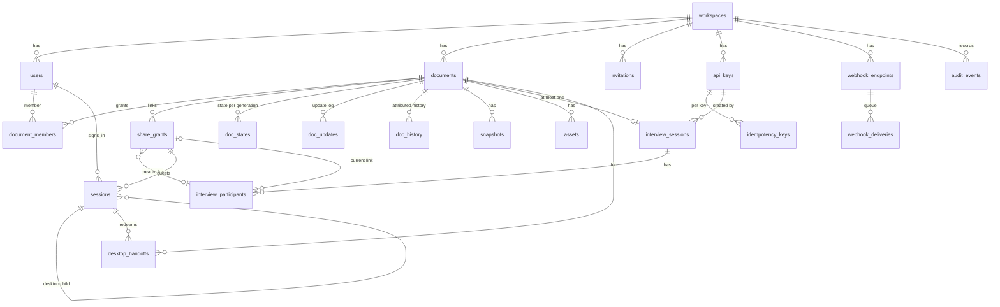

# Database schema

The schema after migrations 0001 to 0004, as read from `apps/server/migrations/*.sql` and the code that
uses it. PostgreSQL 17. Every statement here was checked against the migration files or the named source
file. Query plans were not measured (no `EXPLAIN` was run for this document), so index rationale says which
query an index is meant for, not that the planner picks it.

| Migration | File                   | Adds                                                                                                                                                                                        |
| --------- | ---------------------- | ------------------------------------------------------------------------------------------------------------------------------------------------------------------------------------------- |
| 0001      | `0001_init.sql`        | Extension `citext`, 14 tables, the single workspace row                                                                                                                                     |
| 0002      | `0002_service_api.sql` | `api_keys`, `interview_sessions`, `interview_participants`, `idempotency_keys`, `webhook_endpoints`, `webhook_deliveries`, column `share_grants.participant_id`, wider `audit_events` CHECK |
| 0003      | `0003_history.sql`     | `doc_history`, column `documents.history_seq`                                                                                                                                               |
| 0004      | `0004_releases.sql`    | `release_download_counts`                                                                                                                                                                   |

The runner (`apps/server/src/db/migrate.ts`) also creates `schema_migrations (version integer PRIMARY KEY,
name text, checksum text, applied_at timestamptz)` on first use. It is not in a migration file. After a
rollback "park" (see [upgrade-and-rollback.md](upgrade-and-rollback.md)) a table `schema_migrations_parked`
with the same shape exists until the schema is unparked.

Conventions:

- Identifiers are random UUIDs generated by the server; there are no sequences except the per-document
  counters described below.
- Every workspace-owned row carries `workspace_id` and every query filters by it. One workspace exists per
  deployment (inserted by 0001).
- Secrets are stored as SHA-256 hashes (`bytea`, CHECK length 32), except two values that must be read back
  and are stored encrypted with AES-256-GCM under a key derived from `SESSION_SECRET`: webhook signing secrets
  and stored idempotent responses (see [session-integration.md](session-integration.md)).
- Timestamps are `timestamptz`.

## Entity relationships

Not drawn: `asset_deletions` and `release_download_counts` (no foreign keys), `schema_migrations`.
`doc_history` names users, grants and sessions in plain columns without foreign keys (explained below).

## Tables

Notation: PK primary key, FK foreign key, UQ unique, CASCADE `ON DELETE CASCADE`, SET NULL `ON DELETE SET NULL`.
"Retention" names the rule in `apps/server/src/cleanup.ts` or says that nothing removes the rows.

### workspaces

| Column       | Type        | Notes                 |
| ------------ | ----------- | --------------------- |
| `id`         | uuid        | PK                    |
| `name`       | text        | CHECK length 1 to 120 |
| `created_at` | timestamptz | default `now()`       |

Written by: migration 0001 only (one row). Retention: none.

### users

| Column                     | Type        | Notes                                          |
| -------------------------- | ----------- | ---------------------------------------------- |
| `id`                       | uuid        | PK                                             |
| `workspace_id`             | uuid        | FK `workspaces` CASCADE                        |
| `email`                    | citext      | CHECK length 3 to 254                          |
| `display_name`             | text        | CHECK length 1 to 80                           |
| `password_hash`            | text        | Argon2id with its parameters                   |
| `role`                     | text        | CHECK `admin` or `member`                      |
| `status`                   | text        | default `active`; CHECK `active` or `disabled` |
| `created_at`, `updated_at` | timestamptz | default `now()`                                |

Keys: UQ `(workspace_id, email)` (case-insensitive through `citext`); UQ `(workspace_id, id)` (target of the
composite foreign key of `document_members`).

Written by: `bootstrap-admin` and `reset-password` (CLI), invitation accept, sign-up, `PATCH /api/auth/profile`,
`POST /api/auth/password`, `PATCH /api/users/:userId`. Retention: none (accounts are disabled, not deleted).

### documents

| Column                                           | Type        | Notes                                                                     |
| ------------------------------------------------ | ----------- | ------------------------------------------------------------------------- |
| `id`                                             | uuid        | PK                                                                        |
| `workspace_id`                                   | uuid        | FK `workspaces` CASCADE                                                   |
| `title`                                          | text        | CHECK length 1 to 200                                                     |
| `status`                                         | text        | default `active`; CHECK `active`, `archived`, `trashed`                   |
| `generation`                                     | integer     | default 1; CHECK >= 1. Incremented by a snapshot restore                  |
| `schema_version`                                 | integer     | CHECK >= 1 (document format version)                                      |
| `head_seq`                                       | bigint      | default 0; CHECK >= 0. Last committed `doc_updates.seq` of the generation |
| `history_seq`                                    | bigint      | 0003. NOT NULL default 0. Last `doc_history.hseq`                         |
| `created_by`                                     | uuid        | FK `users` SET NULL                                                       |
| `created_at`, `updated_at`, `content_updated_at` | timestamptz | default `now()`                                                           |
| `archived_at`, `trashed_at`                      | timestamptz | nullable                                                                  |

Keys: UQ `(workspace_id, id)`. Indexes: `documents_workspace_status_idx (workspace_id, status, updated_at DESC)`;
partial `documents_trashed_idx (trashed_at) WHERE status = 'trashed'`.

Written by: document routes, the durable log (`head_seq`, `history_seq`, `content_updated_at`), snapshot
restore (`generation`), cleanup (purge). Retention: trashed documents are deleted after `TRASH_RETENTION_DAYS`
(default 30), which cascades to every child table.

### document_members

| Column         | Type        | Notes                      |
| -------------- | ----------- | -------------------------- |
| `document_id`  | uuid        | FK `documents` CASCADE     |
| `user_id`      | uuid        | FK `users` CASCADE         |
| `workspace_id` | uuid        | FK `workspaces` CASCADE    |
| `role`         | text        | CHECK `viewer` or `editor` |
| `granted_by`   | uuid        | FK `users` SET NULL        |
| `granted_at`   | timestamptz | default `now()`            |

Keys: PK `(document_id, user_id)`. Composite FKs `(workspace_id, document_id)` to `documents (workspace_id, id)`
and `(workspace_id, user_id)` to `users (workspace_id, id)`, both CASCADE, so both sides of a membership must
live in the membership's workspace. Index `document_members_user_idx (user_id)`.
Written by: member routes. Retention: none besides cascades.

### share_grants

| Column                                     | Type        | Notes                                                                 |
| ------------------------------------------ | ----------- | --------------------------------------------------------------------- |
| `id`                                       | uuid        | PK                                                                    |
| `workspace_id`                             | uuid        | FK `workspaces` CASCADE                                               |
| `document_id`                              | uuid        | FK `documents` CASCADE                                                |
| `role`                                     | text        | CHECK `viewer` or `editor`                                            |
| `secret_hash`                              | bytea       | CHECK length 32. SHA-256 of the 32-byte secret                        |
| `label`                                    | text        | default `''`; CHECK length <= 80                                      |
| `created_by`                               | uuid        | FK `users` SET NULL                                                   |
| `created_at`                               | timestamptz | default `now()`                                                       |
| `expires_at`, `revoked_at`, `last_used_at` | timestamptz | nullable                                                              |
| `rotated_from`                             | uuid        | FK `share_grants` SET NULL                                            |
| `participant_id`                           | uuid        | 0002. FK `interview_participants` SET NULL. Set for an interview link |

Composite FK `(workspace_id, document_id)` to `documents (workspace_id, id)` CASCADE.
Indexes: `share_grants_document_idx (document_id, created_at DESC)`; partial
`share_grants_participant_idx (participant_id) WHERE participant_id IS NOT NULL`.
Written by: share routes (create, edit, revoke, rotate, exchange updates `last_used_at`) and the interview
session service (links of participants). Retention: none; revoked and expired rows stay as history.

### sessions

| Column                         | Type              | Notes                                                                                  |
| ------------------------------ | ----------------- | -------------------------------------------------------------------------------------- |
| `id`                           | uuid              | PK                                                                                     |
| `workspace_id`                 | uuid              | FK `workspaces` CASCADE                                                                |
| `kind`                         | text              | CHECK `user`, `share`, `desktop`                                                       |
| `token_hash`                   | bytea             | UQ; CHECK length 32                                                                    |
| `user_id`                      | uuid              | FK `users` CASCADE                                                                     |
| `share_grant_id`               | uuid              | FK `share_grants` CASCADE                                                              |
| `document_id`                  | uuid              | FK `documents` CASCADE                                                                 |
| `parent_session_id`            | uuid              | FK `sessions` CASCADE (a desktop session is a child of the session that handed it off) |
| `guest_name`                   | text              | server-generated display name of a link guest                                          |
| `created_at`, `last_seen_at`   | timestamptz       | default `now()`                                                                        |
| `expires_at`                   | timestamptz       | NOT NULL, absolute expiry                                                              |
| `revoked_at`, `revoked_reason` | timestamptz, text | nullable                                                                               |

Table CHECK: `user` needs `user_id` and neither grant nor document; `share` needs grant and document and no
user; `desktop` needs a document and exactly one of user or grant.
Indexes: partial `sessions_user_idx (user_id)`, `sessions_grant_idx (share_grant_id)`,
`sessions_parent_idx (parent_session_id)` (each `WHERE ... IS NOT NULL`); `sessions_expires_idx (expires_at)`.
Written by: sign-in, share exchange, desktop redemption, sign-out and revocation paths. Retention: rows whose
expiry or revocation is older than `SESSION_RETENTION_DAYS` (default 30) are deleted by cleanup.

### invitations

| Column                      | Type        | Notes                     |
| --------------------------- | ----------- | ------------------------- |
| `id`                        | uuid        | PK                        |
| `workspace_id`              | uuid        | FK `workspaces` CASCADE   |
| `secret_hash`               | bytea       | CHECK length 32           |
| `email`                     | citext      | nullable                  |
| `role`                      | text        | CHECK `admin` or `member` |
| `created_by`, `accepted_by` | uuid        | FK `users` SET NULL       |
| `created_at`                | timestamptz | default `now()`           |
| `expires_at`                | timestamptz | NOT NULL                  |
| `accepted_at`, `revoked_at` | timestamptz | nullable                  |

Index: `invitations_workspace_idx (workspace_id, created_at DESC)`. Written by: invitation routes.
Retention: none.

### doc_states

Compacted Yjs state per document generation.

| Column         | Type        | Notes                                                          |
| -------------- | ----------- | -------------------------------------------------------------- |
| `document_id`  | uuid        | FK `documents` CASCADE                                         |
| `generation`   | integer     | CHECK >= 1                                                     |
| `workspace_id` | uuid        | FK `workspaces` CASCADE                                        |
| `state`        | bytea       |                                                                |
| `upto_seq`     | bigint      | default 0; CHECK >= 0. The state contains every update <= this |
| `updated_at`   | timestamptz | default `now()`                                                |

Key: PK `(document_id, generation)`. Written by: `PgLogStore.compact`, snapshot restore, document creation and
duplication. Retention: kept with the document.

### doc_updates

Append-only Yjs update log of the current generation; compaction deletes the rows it folds into `doc_states`.

| Column         | Type        | Notes                                             |
| -------------- | ----------- | ------------------------------------------------- |
| `document_id`  | uuid        | FK `documents` CASCADE                            |
| `generation`   | integer     | CHECK >= 1                                        |
| `seq`          | bigint      | CHECK >= 1. Gap-free and monotonic per generation |
| `workspace_id` | uuid        | FK `workspaces` CASCADE                           |
| `update`       | bytea       |                                                   |
| `created_at`   | timestamptz | default `now()`                                   |

Key: PK `(document_id, generation, seq)`. Written by: `PgLogStore.append` and `compact`
(`apps/server/src/collab/pg-log-store.ts`). Retention: rows at or below the compaction boundary are deleted by
the compaction itself (after `COLLAB_COMPACT_AFTER_UPDATES`, default 200). This table is not a history; use
`doc_history`.

### snapshots

| Column         | Type        | Notes                                              |
| -------------- | ----------- | -------------------------------------------------- |
| `id`           | uuid        | PK                                                 |
| `workspace_id` | uuid        | FK `workspaces` CASCADE                            |
| `document_id`  | uuid        | FK `documents` CASCADE                             |
| `name`         | text        | CHECK length 1 to 120                              |
| `kind`         | text        | CHECK `named` or `pre_restore`                     |
| `generation`   | integer     | CHECK >= 1. Generation the snapshot was taken from |
| `state`        | bytea       | full Yjs state                                     |
| `size_bytes`   | integer     | CHECK >= 0                                         |
| `asset_ids`    | uuid[]      | default `{}`. Keeps those assets from cleanup      |
| `created_by`   | uuid        | FK `users` SET NULL                                |
| `created_at`   | timestamptz | default `now()`                                    |

Index: `snapshots_document_idx (document_id, created_at DESC)`. Written by: snapshot routes, version history
("name this version", "restore this version"). Retention: `pre_restore` snapshots are deleted after
`PRE_RESTORE_SNAPSHOT_RETENTION_DAYS` (default 90); named snapshots stay until deleted.

### assets

| Column               | Type        | Notes                                          |
| -------------------- | ----------- | ---------------------------------------------- |
| `id`                 | uuid        | PK                                             |
| `workspace_id`       | uuid        | FK `workspaces` CASCADE                        |
| `document_id`        | uuid        | FK `documents` CASCADE                         |
| `kind`               | text        | CHECK `image` or `attachment`                  |
| `storage_key`        | text        | UQ. Random key inside the private asset volume |
| `name`               | text        | CHECK length 1 to 255                          |
| `mime`               | text        | verified type                                  |
| `size_bytes`         | bigint      | CHECK >= 0                                     |
| `width`, `height`    | integer     | nullable                                       |
| `sha256`             | bytea       | CHECK length 32                                |
| `status`             | text        | CHECK `pending` or `ready`                     |
| `uploaded_by`        | uuid        | FK `users` SET NULL                            |
| `created_at`         | timestamptz | default `now()`                                |
| `unreferenced_since` | timestamptz | set by cleanup                                 |

Index: `assets_document_idx (document_id, status)`. Written by: the upload route and cleanup.
Retention: an asset not referenced by the live document, any snapshot or any retained history row for
`ASSET_GRACE_DAYS` (default 30), seen by two cleanup runs, is deleted; pending uploads older than
`PENDING_UPLOAD_HOURS` (default 24) are removed.

### asset_deletions

| Column        | Type        | Notes           |
| ------------- | ----------- | --------------- |
| `storage_key` | text        | PK              |
| `not_before`  | timestamptz | default `now()` |

No foreign keys. A file whose row is gone, or a file created before its row (duplicating a document). The row
is written in the same transaction that removes the asset, so a crash cannot leak bytes. Drained by cleanup
and the asset service.

### desktop_handoffs

| Column         | Type        | Notes                                                     |
| -------------- | ----------- | --------------------------------------------------------- |
| `id`           | uuid        | PK                                                        |
| `workspace_id` | uuid        | FK `workspaces` CASCADE                                   |
| `code_hash`    | bytea       | UQ; CHECK length 32. Single-use code, hashed              |
| `document_id`  | uuid        | FK `documents` CASCADE                                    |
| `session_id`   | uuid        | FK `sessions` CASCADE. Session that asked for the handoff |
| `created_at`   | timestamptz | default `now()`                                           |
| `expires_at`   | timestamptz | NOT NULL                                                  |
| `used_at`      | timestamptz | nullable                                                  |

Index: `desktop_handoffs_expires_idx (expires_at)`. Written by: desktop routes. Retention: deleted one day
after expiry.

### audit_events

| Column                     | Type        | Notes                                                              |
| -------------------------- | ----------- | ------------------------------------------------------------------ |
| `id`                       | uuid        | PK                                                                 |
| `workspace_id`             | uuid        | FK `workspaces` CASCADE                                            |
| `at`                       | timestamptz | default `now()`                                                    |
| `actor_kind`               | text        | CHECK `user`, `guest`, `system`, **`service`** (widened by 0002)   |
| `actor_user_id`            | uuid        | FK `users` SET NULL                                                |
| `actor_name`               | text        | nullable                                                           |
| `action`                   | text        | NOT NULL                                                           |
| `target_type`, `target_id` | text        | nullable                                                           |
| `details`                  | jsonb       | default `{}`. Never document content, passwords, secrets or tokens |
| `request_id`               | text        | the request id, so a person's quoted id can be found               |

Index: `audit_events_workspace_at_idx (workspace_id, at DESC)`. Written by many routes through `writeAudit`
(`apps/server/src/audit.ts`). Retention: `AUDIT_RETENTION_DAYS` (default 365).

Migration 0002 changes the CHECK by `DROP CONSTRAINT IF EXISTS` and `ADD CONSTRAINT`. PostgreSQL validates
every existing row when the new constraint is added, under an `ACCESS EXCLUSIVE` lock on `audit_events` for
the length of that validation. The lock is brief while the table is small. It is the only statement of the
four migrations that scans an existing table.

### api_keys (0002)

| Column                                     | Type        | Notes                                                                     |
| ------------------------------------------ | ----------- | ------------------------------------------------------------------------- |
| `id`                                       | uuid        | PK                                                                        |
| `workspace_id`                             | uuid        | FK `workspaces` CASCADE                                                   |
| `name`                                     | text        | CHECK length 1 to 80                                                      |
| `key_prefix`                               | text        | UQ; CHECK matches `^rdk_[A-Za-z0-9]{8}$`. Public, used to look the key up |
| `secret_hash`                              | bytea       | CHECK length 32. SHA-256 of the complete key; the key is shown once       |
| `scopes`                                   | text[]      | CHECK at least one                                                        |
| `allowed_cidrs`                            | text[]      | nullable address allow-list                                               |
| `expires_at`, `last_used_at`, `revoked_at` | timestamptz | nullable. `last_used_at` is updated at most once a minute                 |
| `created_by`                               | uuid        | FK `users` SET NULL                                                       |
| `created_at`                               | timestamptz | default `now()`                                                           |
| `rotated_from`                             | uuid        | FK `api_keys` SET NULL                                                    |

Index: `api_keys_workspace_idx (workspace_id, created_at DESC)`. Written by: `/api/admin/api-keys` routes and
key authentication (`last_used_at`). Retention: none; revoked keys stay as history.

### interview_sessions (0002)

| Column                                                      | Type        | Notes                                                                                       |
| ----------------------------------------------------------- | ----------- | ------------------------------------------------------------------------------------------- |
| `id`                                                        | uuid        | PK                                                                                          |
| `workspace_id`                                              | uuid        | FK `workspaces` CASCADE                                                                     |
| `document_id`                                               | uuid        | UQ; FK `documents` CASCADE. One session per document                                        |
| `status`                                                    | text        | default `scheduled`; CHECK `scheduled`, `in_progress`, `completed`, `cancelled`, `archived` |
| `company_name`                                              | text        | CHECK length 1 to 120                                                                       |
| `round_number`                                              | integer     | CHECK >= 1                                                                                  |
| `round_name`                                                | text        | nullable; CHECK length <= 120                                                               |
| `scheduled_at`                                              | timestamptz | NOT NULL                                                                                    |
| `timezone`                                                  | text        | NOT NULL                                                                                    |
| `expires_at`                                                | timestamptz | NOT NULL                                                                                    |
| `permissions`                                               | jsonb       | default `{}`                                                                                |
| `metadata`                                                  | jsonb       | default `{}`. Caller-supplied string pairs, including the external interview id             |
| `generated_title`                                           | text        | NOT NULL                                                                                    |
| `created_by_key_id`                                         | uuid        | FK `api_keys` SET NULL                                                                      |
| `created_by_user_id`                                        | uuid        | FK `users` SET NULL                                                                         |
| `first_edited_at`                                           | timestamptz | set once; makes `document.first_edited` fire once                                           |
| `created_at`, `updated_at`                                  | timestamptz | default `now()`                                                                             |
| `started_at`, `completed_at`, `cancelled_at`, `archived_at` | timestamptz | nullable                                                                                    |

Indexes: `interview_sessions_list_idx (workspace_id, created_at DESC, id DESC)`;
`interview_sessions_status_idx (workspace_id, status, scheduled_at)`.
Written by: the v1 routes and their `/api/admin` mirrors (`apps/server/src/service/sessions.ts`) and, for
`first_edited_at`, the collaboration layer through `emitDocumentFirstEdited`. Retention: none besides the
cascade from the document.

### interview_participants (0002)

| Column                                            | Type        | Notes                                                                  |
| ------------------------------------------------- | ----------- | ---------------------------------------------------------------------- |
| `id`                                              | uuid        | PK                                                                     |
| `workspace_id`                                    | uuid        | FK `workspaces` CASCADE                                                |
| `session_id`                                      | uuid        | FK `interview_sessions` CASCADE                                        |
| `role`                                            | text        | CHECK `candidate` or `interviewer`                                     |
| `name`                                            | text        | CHECK length 1 to 120                                                  |
| `email`                                           | citext      | CHECK length 3 to 254                                                  |
| `share_grant_id`                                  | uuid        | FK `share_grants` SET NULL. The current link; older links stay revoked |
| `created_at`                                      | timestamptz | default `now()`                                                        |
| `removed_at`, `first_joined_at`, `last_joined_at` | timestamptz | nullable                                                               |

Indexes: `interview_participants_session_idx (session_id, created_at)`;
`interview_participants_email_idx (workspace_id, email)`; partial
`interview_participants_grant_idx (share_grant_id) WHERE share_grant_id IS NOT NULL`.
Written by: the interview session service. Retention: cascade only. The table holds e-mail addresses of
candidates; nothing deletes them until the document is purged.

### idempotency_keys (0002)

| Column         | Type        | Notes                                                                      |
| -------------- | ----------- | -------------------------------------------------------------------------- |
| `workspace_id` | uuid        | FK `workspaces` CASCADE                                                    |
| `api_key_id`   | uuid        | FK `api_keys` CASCADE                                                      |
| `key`          | text        | CHECK length 1 to 128                                                      |
| `request_hash` | text        | NOT NULL                                                                   |
| `response`     | jsonb       | NULL while the first request runs. Stored encrypted as `{"enc": "v1:..."}` |
| `status_code`  | integer     |                                                                            |
| `created_at`   | timestamptz | default `now()`                                                            |

Key: UQ `(api_key_id, key)` (no separate primary key). Index `idempotency_keys_created_idx (created_at)`.
Written by: `POST /api/v1/interview-sessions` (`apps/server/src/service/idempotency.ts`). Retention: deleted
24 hours after creation by cleanup. A claim without a result older than 120 seconds can be taken over.

### webhook_endpoints (0002)

| Column               | Type        | Notes                                                     |
| -------------------- | ----------- | --------------------------------------------------------- |
| `id`                 | uuid        | PK                                                        |
| `workspace_id`       | uuid        | FK `workspaces` CASCADE                                   |
| `url`                | text        | CHECK length <= 2048                                      |
| `secret`             | text        | AES-256-GCM ciphertext, key derived from `SESSION_SECRET` |
| `events`             | text[]      | CHECK at least one                                        |
| `enabled`            | boolean     | default true                                              |
| `created_by_key_id`  | uuid        | FK `api_keys` SET NULL                                    |
| `created_by_user_id` | uuid        | FK `users` SET NULL                                       |
| `created_at`         | timestamptz | default `now()`                                           |
| `disabled_at`        | timestamptz | nullable                                                  |

Index: `webhook_endpoints_workspace_idx (workspace_id, created_at DESC)`. Written by: webhook routes.
Retention: none.

### webhook_deliveries (0002)

| Column             | Type        | Notes                                                             |
| ------------------ | ----------- | ----------------------------------------------------------------- |
| `id`               | uuid        | PK                                                                |
| `workspace_id`     | uuid        | FK `workspaces` CASCADE                                           |
| `endpoint_id`      | uuid        | FK `webhook_endpoints` CASCADE                                    |
| `event_id`         | uuid        | NOT NULL                                                          |
| `event_type`       | text        | NOT NULL                                                          |
| `payload`          | jsonb       | NOT NULL. Never document content or access secrets                |
| `status`           | text        | default `pending`; CHECK `pending`, `delivered`, `failed`, `dead` |
| `attempts`         | integer     | default 0                                                         |
| `next_attempt_at`  | timestamptz | default `now()`. Pushed out while an attempt runs (the lease)     |
| `last_status_code` | integer     |                                                                   |
| `last_error`       | text        |                                                                   |
| `created_at`       | timestamptz | default `now()`                                                   |
| `delivered_at`     | timestamptz | nullable                                                          |

Indexes: partial `webhook_deliveries_due_idx (next_attempt_at) WHERE status IN ('pending','failed')`;
`webhook_deliveries_endpoint_idx (endpoint_id, created_at DESC, id DESC)`.
Written by: `emitWebhookEvent` (inside the transaction of the change that caused the event) and the delivery
worker (`apps/server/src/service/webhooks.ts`). **Retention: none.** No cleanup rule deletes delivered or
dead deliveries; the table grows with every event until its endpoint (cascade) or workspace is deleted. See
"What is deliberately not done".

### doc_history (0003)

One row per actor per committed batch, plus `checkpoint` rows holding a complete state.

| Column                            | Type        | Notes                                                                              |
| --------------------------------- | ----------- | ---------------------------------------------------------------------------------- |
| `document_id`                     | uuid        | FK `documents` CASCADE                                                             |
| `hseq`                            | bigint      | Revision number. Monotonic per document across generations, assigned by the server |
| `workspace_id`                    | uuid        | FK `workspaces` (no `ON DELETE` action: the default `NO ACTION`)                   |
| `generation`                      | integer     | NOT NULL                                                                           |
| `seq`                             | bigint      | `doc_updates.seq` of the commit (`head_seq` for checkpoints)                       |
| `kind`                            | text        | CHECK `update` or `checkpoint`                                                     |
| `operation_type`                  | text        | NOT NULL (vocabulary in `packages/contracts/src/history.ts`)                       |
| `actor_kind`                      | text        | CHECK `user`, `guest`, `service`, `system`                                         |
| `actor_user_id`, `actor_grant_id` | uuid        | nullable, **no foreign key**                                                       |
| `actor_name`                      | text        | NOT NULL. The name at the time of the change                                       |
| `participant_role`                | text        | nullable                                                                           |
| `session_id`                      | uuid        | nullable, no foreign key                                                           |
| `connection_id`                   | text        | nullable                                                                           |
| `client_id`                       | bigint      | nullable (Yjs client id)                                                           |
| `transaction_id`                  | uuid        | NOT NULL. One id for everything committed together                                 |
| `server_received_at`              | timestamptz | NOT NULL. Server clock                                                             |
| `server_committed_at`             | timestamptz | NOT NULL, default `clock_timestamp()`                                              |
| `client_occurred_at`              | timestamptz | nullable. Reported by the client, untrusted                                        |
| `content_size_delta`              | integer     | default 0                                                                          |
| `summary`                         | jsonb       | default `{}`. Counts and kinds, never document text                                |
| `attachment_ids`                  | uuid[]      | default `{}`. Assets the row added (all assets in the state for a checkpoint)      |
| `schema_version`                  | integer     | NOT NULL                                                                           |
| `update`                          | bytea       | NOT NULL. Yjs update (a complete state for a checkpoint)                           |

Key: PK `(document_id, hseq)`. Indexes: partial `doc_history_actor_idx (document_id, actor_user_id, hseq DESC)
WHERE actor_user_id IS NOT NULL`; partial `doc_history_checkpoint_idx (document_id, generation, hseq DESC)
WHERE kind = 'checkpoint'`; `doc_history_committed_idx (workspace_id, server_committed_at)`.

The actor columns have no foreign keys by design (comment in 0003): history must stay writable and readable
whatever happens to the account, link or session it names.

Written by: `PgLogStore.append` (rows of the commit, in the same statement as the `doc_updates` insert),
`compact` (checkpoint, when `HISTORY_CHECKPOINT_EVERY` rows have accumulated) and `baseline` (starting state of
a generation, and the "History starts here" row for a document that existed before the upgrade).
Retention: `HISTORY_RETENTION_DAYS` (default 0, keep everything). With a limit set, cleanup deletes rows that
lie before the newest checkpoint older than the limit, per document and generation, so every remaining row can
still be rebuilt. Rows are otherwise removed only with the document.

### release_download_counts (0004)

| Column     | Type   | Notes                                           |
| ---------- | ------ | ----------------------------------------------- |
| `day`      | date   | UTC day                                         |
| `channel`  | text   | CHECK `stable` or `beta`                        |
| `version`  | text   | CHECK length <= 64                              |
| `platform` | text   | CHECK `windows`, `macos`, `linux`               |
| `arch`     | text   | CHECK `x64`, `arm64`, `universal`               |
| `format`   | text   | CHECK `zip`, `exe`, `dmg`, `appimage`, `tar.gz` |
| `count`    | bigint | default 0; CHECK >= 0                           |

Key: PK `(day, channel, version, platform, arch, format)`. Index `release_download_counts_version_idx
(channel, version)`. Written by: the artifact download route with `INSERT ... ON CONFLICT DO UPDATE SET count =
count + 1`. Stores no address, user agent or person. Retention: none (one row per day and artifact kind, so it
grows slowly).

## Transactions and locking

| Place                                                                   | Mechanism                                                                                                                                                                                                                                                                                                                                                                                                                                                                |
| ----------------------------------------------------------------------- | ------------------------------------------------------------------------------------------------------------------------------------------------------------------------------------------------------------------------------------------------------------------------------------------------------------------------------------------------------------------------------------------------------------------------------------------------------------------------ |
| Appending a batch of edits                                              | `PgLogStore.append`: one SQL statement. A CTE locks the document row (`SELECT ... FOR UPDATE`), inserts into `doc_updates` only if `generation` and `head_seq` match what the writer expects, inserts the `doc_history` rows, and updates `documents.head_seq`, `content_updated_at` and `history_seq`. A writer with a stale idea of `head_seq` inserts nothing and the caller gets a sequence conflict. The acknowledgement ("Saved") is sent only after this commits. |
| Compaction                                                              | `PgLogStore.compact`: one statement, same row lock. Upserts `doc_states`, deletes `doc_updates` at or below the boundary, optionally inserts a checkpoint into `doc_history`. A boundary that does not match `head_seq` stores nothing.                                                                                                                                                                                                                                  |
| History baseline                                                        | `PgLogStore.baseline`: same row lock; writes nothing if history already reaches the head of the log (another instance recorded it first).                                                                                                                                                                                                                                                                                                                                |
| Snapshot restore, duplicate, durable state read for a generation change | `loadDurableState(..., forUpdate = true)` locks the document row inside the caller's transaction.                                                                                                                                                                                                                                                                                                                                                                        |
| Other row locks                                                         | `FOR UPDATE` on the row being changed in: user changes, share-grant changes, invitation accept, API key changes, desktop handoff redemption, interview session and participant changes.                                                                                                                                                                                                                                                                                  |
| Migrations                                                              | Session-level `pg_advisory_lock(0x72646d67)` on one connection, each migration in its own `BEGIN`/`COMMIT` with its row in `schema_migrations`. `statement_timeout` and `lock_timeout` are set to 0 on that connection, which is not returned to the pool. Several instances may start together; the others wait.                                                                                                                                                        |
| Cleanup                                                                 | Session-level `pg_try_advisory_lock(0x7264636c)`. The loser returns `skipped: true` immediately. Individual purge steps run in their own transactions.                                                                                                                                                                                                                                                                                                                   |
| Asset quota                                                             | `pg_advisory_xact_lock(hashtextextended('rd-asset-quota:'                                                                                                                                                                                                                                                                                                                                                                                                                |     | documentId, 0))`inside the upload transaction, so two concurrent uploads to one document cannot both pass the quota check. It does not lock the`documents` row, so editing is not blocked by an upload. |
| First administrator                                                     | `pg_advisory_xact_lock(hashtextextended('rd-bootstrap-admin', 0))` so two simultaneous commands cannot both create the first account.                                                                                                                                                                                                                                                                                                                                    |
| Webhook deliveries                                                      | Claim: one `UPDATE ... WHERE id IN (SELECT ... FOR UPDATE OF d SKIP LOCKED)` that increments `attempts` and pushes `next_attempt_at` out by a lease. The HTTP call runs after the claim commits, so no transaction or lock is held during it, and several instances never claim the same row.                                                                                                                                                                            |
| Webhook events                                                          | Inserted in the transaction of the change that caused them, so an event exists if and only if the change committed.                                                                                                                                                                                                                                                                                                                                                      |
| Idempotency                                                             | The claim is a unique insert on `(api_key_id, key)`; the stored response is written in the transaction that creates the session, so a crash leaves either nothing or the full result.                                                                                                                                                                                                                                                                                    |

## Pagination

| Endpoint family                                       | Pattern                                                                                                                                                                                                                                                                                                                                  |
| ----------------------------------------------------- | ---------------------------------------------------------------------------------------------------------------------------------------------------------------------------------------------------------------------------------------------------------------------------------------------------------------------------------------- |
| Interview sessions, webhook deliveries, session audit | Keyset on `(created_at or at, id)` newest first. An opaque base64url cursor carries the last row's timestamp and id (`apps/server/src/service/pagination.ts`). The query fetches `limit + 1` rows to know whether another page exists. The comparison uses `date_trunc('milliseconds', ...)` because JSON timestamps carry milliseconds. |
| Version history                                       | Keyset on the revision: `before=<hseq>` returns rows with `hseq <` that value, `limit + 1` fetched, `nextBefore` returned. Administrative events are returned on the first page only (up to 200). The export walks pages of 200 up to 50,000 rows.                                                                                       |
| Documents list                                        | No pagination: a fixed limit of 500 rows (12 for "recent"), ordered by `updated_at DESC`.                                                                                                                                                                                                                                                |
| Admin audit log                                       | `limit` only, newest first, no cursor.                                                                                                                                                                                                                                                                                                   |

No endpoint uses `OFFSET`.

## Why each index exists

The queries named are the ones the code runs (file in brackets). "Per the migration" means the reason is the
migration's own comment and the query was not traced.

| Index                                                      | Serves                                                                                                                                                                                                                        |
| ---------------------------------------------------------- | ----------------------------------------------------------------------------------------------------------------------------------------------------------------------------------------------------------------------------- |
| `users` UQ `(workspace_id, email)`                         | Sign-in lookup by e-mail; uniqueness.                                                                                                                                                                                         |
| `documents_workspace_status_idx`                           | The document list: `WHERE workspace_id AND status ... ORDER BY updated_at DESC` [`routes/documents.ts`].                                                                                                                      |
| `documents_trashed_idx` (partial)                          | The purge sweep over trashed documents; stays tiny because only trashed rows are in it.                                                                                                                                       |
| `document_members_user_idx`                                | Memberships of one account, per the migration. The primary key already serves "who is a member of this document".                                                                                                             |
| `share_grants_document_idx`                                | Share links of one document, newest first.                                                                                                                                                                                    |
| `share_grants_participant_idx` (partial)                   | Finding the links of an interview participant; only interview links are in it.                                                                                                                                                |
| `sessions` UQ `token_hash`                                 | Every authenticated request looks the session up by token hash.                                                                                                                                                               |
| `sessions_user_idx`, `_grant_idx`, `_parent_idx` (partial) | Sessions of an account, of a share link, or the children of a session (revocation), per the migration. Partial because each column is NULL for the other kinds.                                                               |
| `sessions_expires_idx`                                     | The retention sweep by expiry.                                                                                                                                                                                                |
| `invitations_workspace_idx`                                | The invitation list.                                                                                                                                                                                                          |
| `doc_updates` PK `(document_id, generation, seq)`          | Loading a document (range read after `upto_seq`), the append, and the compaction delete. No other index is needed.                                                                                                            |
| `snapshots_document_idx`                                   | The snapshot list of a document.                                                                                                                                                                                              |
| `assets_document_idx`                                      | Assets of a document, the quota sum and the cleanup scan.                                                                                                                                                                     |
| `assets` UQ `storage_key`                                  | Uniqueness of the random key.                                                                                                                                                                                                 |
| `desktop_handoffs` UQ `code_hash`; `_expires_idx`          | Redeeming a code; the retention sweep.                                                                                                                                                                                        |
| `audit_events_workspace_at_idx`                            | The audit list (`ORDER BY at DESC`) and the retention delete by age.                                                                                                                                                          |
| `api_keys` UQ `key_prefix`                                 | Looking a key up from the public prefix of the bearer token. `api_keys_workspace_idx`: the key list.                                                                                                                          |
| `interview_sessions_list_idx`                              | The list `ORDER BY created_at DESC, id DESC` with a keyset. The query orders by `date_trunc('milliseconds', created_at)`, an expression the index does not contain, so whether the index supplies the order was not verified. |
| `interview_sessions_status_idx`                            | Filtering by `status` and `scheduled_at`, per the migration.                                                                                                                                                                  |
| `interview_sessions` UQ `document_id`                      | One session per document; the collaboration layer finds the session of a document to emit `document.first_edited`.                                                                                                            |
| `interview_participants_session_idx`                       | Participants of a session in creation order.                                                                                                                                                                                  |
| `interview_participants_email_idx`                         | Lookups by e-mail, per the migration. The list filters `candidateEmail` and `interviewerEmail` use `ILIKE '%term%'`, which a btree cannot serve, so this index does not help those filters.                                   |
| `interview_participants_grant_idx` (partial)               | Finding the participant that owns a share link, per the migration (not traced to a query).                                                                                                                                    |
| `idempotency_keys` UQ `(api_key_id, key)`                  | The claim and the replay lookup. `idempotency_keys_created_idx`: the 24 hour retention delete.                                                                                                                                |
| `webhook_endpoints_workspace_idx`                          | The endpoint list.                                                                                                                                                                                                            |
| `webhook_deliveries_due_idx` (partial)                     | The worker's claim: due rows in `pending` or `failed` ordered by `next_attempt_at`. Partial so delivered and dead rows, which are the majority over time, are not in it.                                                      |
| `webhook_deliveries_endpoint_idx`                          | The delivery list of one endpoint, newest first, keyset.                                                                                                                                                                      |
| `doc_history` PK `(document_id, hseq)`                     | The timeline (`hseq < before ORDER BY hseq DESC`), a revision by number, and the rows after a checkpoint. This is the main access path.                                                                                       |
| `doc_history_actor_idx` (partial)                          | Timeline filter "by person" within one document. Partial: rows of guests, services and the system have no `actor_user_id`.                                                                                                    |
| `doc_history_checkpoint_idx` (partial)                     | "Latest checkpoint at or before a revision" when rebuilding it. Partial: checkpoints are a small share of rows.                                                                                                               |
| `doc_history_committed_idx`                                | The age-based retention sweep, per the migration.                                                                                                                                                                             |
| `release_download_counts` PK; `_version_idx`               | The upsert per day and artifact (verified). `_version_idx` serves totals per release, per the migration (not traced to a query).                                                                                              |

## What is deliberately not done

- **No partitioning.** Not `doc_history`, not `audit_events`, not `webhook_deliveries`. There is no volume
  that justifies it yet (decision of 2026-11-12 in [decisions.md](decisions.md)); the primary key and the
  retention sweep cover the access paths. If `doc_history` grows large, partitioning by `document_id` hash is
  the first thing to evaluate, as a new migration with a measured reason.
- **No index on `doc_history (server_received_at)`, `summary` or `attachment_ids`.** How date filters and the
  asset sweep read `doc_history` was not traced for this document.
- **No foreign keys from `doc_history` to users, grants or sessions** (so history survives their deletion).
- **No trigram or full-text index** for the substring filters of the interview session list.
- **No index on `webhook_deliveries (status)`** besides the partial index above; the dead letter list is read
  through the endpoint index.
- **No unique constraint on the generated document title.** Uniqueness is checked in application code against
  non-trashed documents, so two simultaneous creations with identical inputs can collide ([decisions.md](decisions.md)).
- **No retention for `webhook_deliveries`, `api_keys`, `interview_sessions`, `interview_participants`,
  `webhook_endpoints`, `release_download_counts`, `invitations` or `share_grants`.** Only the tables named
  under "Retention" above are trimmed. This is a gap: delivery rows and participant e-mail addresses are kept
  until their document or endpoint is purged.
- **Migrations are additive and forward only.** There are no down migrations; rollback of the application
  parks the migration records instead ([upgrade-and-rollback.md](upgrade-and-rollback.md)).
