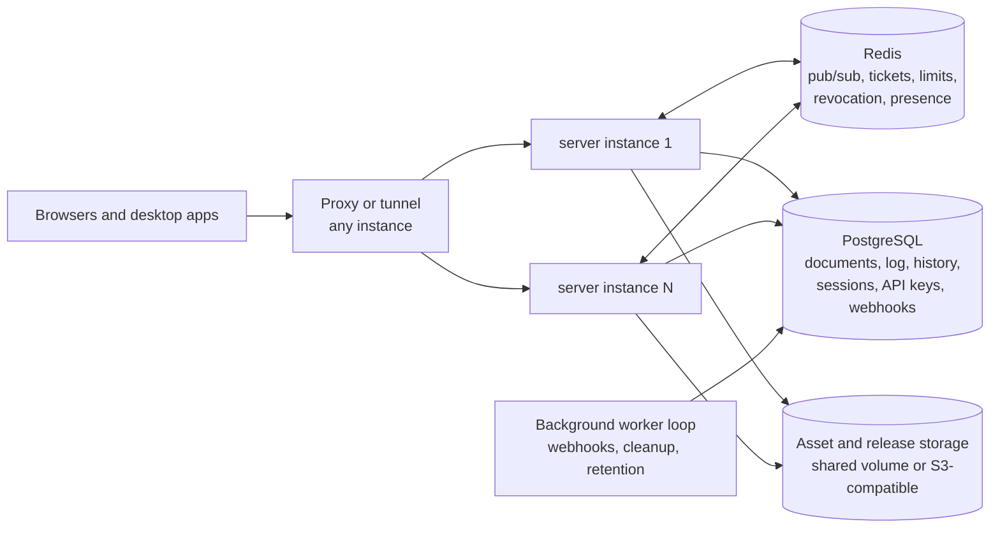

# Enterprise upgrade plan

_Written 2026-11-12 from a read-only audit of the repository and of the host. It is updated as phases
land; the state of each phase is recorded in [status.md](status.md)._

Status labels used here and in the final report: **IMPLEMENTED AND VERIFIED**, **IMPLEMENTED BUT NOT
NATIVE-TESTED**, **CONFIGURED BUT REQUIRES CREDENTIAL**, **PARTIALLY IMPLEMENTED**, **BLOCKED WITH EXACT
REASON**.

## 0. Production status of this host

This host (`spark-0e68`, Ubuntu 24.04, arm64) **is production**. The Compose project `realtimedocs`
(`realtimedocs-db-1`, `realtimedocs-server-1`, `realtimedocs-tunnel-1`, plus `realtimedocs-volume-guard`)
serves `https://realdocs.techsarasolutions.com` through a Cloudflare Tunnel. Ports `127.0.0.1:4310` and
`127.0.0.1:54310`; data volumes `realtimedocs_rd_pgdata` and `realtimedocs_rd_assets`; secrets in
`deploy/.env.production` and `deploy/.env.tunnel` (mode 600, ignored by Git, not in the image).

Rules for this upgrade:

- Nothing in this work runs `docker compose` in the repository root, `pnpm db:up`, `pnpm db:down`, a seed, a
  restore, or a migration against that project. The live deployment is changed only by `deploy/up.sh`, by
  the owner's decision, after the gates pass and after a verified backup.
- All verification uses throw-away resources with their own names and ports: `rd-srv-*` (4410–4419,
  54410–54419), `rd-e2e-*` (4330–4332, 54330), `rd-perf-*` (4320–4322, 54320), `rd-web-*` (4430–4432,
  54430), `rd-ed-*` (4420–4429) and, new in this upgrade, `rd-load-*` (4450–4469, PostgreSQL 15450, Redis 16450), `rd-srv-redis-test` (16410), `rd-rehearse-*` (15460, 4462) and `rd-scale-trial` (4460, 4463, 15463).
- `vite dev` proxies to `127.0.0.1:4310` by default, which is the live server. Development and tests set
  `RD_API_PROXY=off` or `RD_API_TARGET`.
- Git history is not touched. The owner commits.

## 1. Current architecture

One Node.js process (`apps/server`): Fastify 5 HTTP API, Hocuspocus 4 collaboration endpoint at `/collab`,
a durable per-document update log in PostgreSQL 17, a local-disk asset store, and the built React web app.
Clients: the web app (`apps/web`, React 19, Vite 8, React Router 8) and the Electron 45 desktop app
(`apps/desktop`). Web and desktop share `packages/editor` (Tiptap 3, schema, collaboration session,
clipboard, uploads), `packages/contracts` (zod schemas, typed client, versions) and `packages/ui`. Details:
[architecture.md](architecture.md).

Facts that shape this plan:

| Area          | What exists                                                                                                                                                                                                   |
| ------------- | ------------------------------------------------------------------------------------------------------------------------------------------------------------------------------------------------------------- |
| Database      | One migration (`0001_init.sql`), an ordered runner with checksums and an advisory lock. Role and principal vocabularies are `CHECK` constraints.                                                              |
| Authorization | One function, `resolveAccess`, for every route and every collaboration ticket. Workspace roles `admin` and `member`; document roles `viewer` and `editor`; share grants.                                      |
| Durability    | `DurableLog` per loaded document: ordered queue, group commit, gap-free `seq`, acknowledgement only after commit. Compaction **deletes** `doc_updates`; the log is not a history.                             |
| Attribution   | The authenticated connection is known when an update is enqueued and is dropped there. Batches merge updates of several people into one row. `doc_updates` has no actor column.                               |
| Shared state  | One Yjs type, the `default` XML fragment. No shared document metadata. Title lives in the database.                                                                                                           |
| Versions      | `DOCUMENT_SCHEMA_VERSION = 2`, `COLLAB_PROTOCOL_VERSION = 1`, checked when a ticket is issued and again on authentication. A stale client gets `update_required`.                                             |
| Uploads       | Streaming multipart, magic-byte sniffing, strict SVG validation, quota. Client queue with three parallel uploads and no automatic retry.                                                                      |
| Downloads     | Four fixed file names in `DOWNLOAD_DIR`, optional `release.json`. No manifest by platform, no channels. The packager's file names do not match the server's allow-list.                                       |
| Desktop       | Sandbox, context isolation, no Node integration, validated IPC, strict navigation policy. Packaging by `@electron/packager` scripts. No auto-update. No CI.                                                   |
| Scale         | Per-process: loaded documents and write queues, collaboration tickets, rate-limit counters, the connection registry used for revocation, presence, the asset disk. Load was measured with at most 10 clients. |
| Observability | Structured pino logs with redaction and request ids. No metrics.                                                                                                                                              |

## 2. Existing working features (preserved)

Accounts, invitations, optional sign-up, sessions with CSRF protection; documents with archive, trash and
restore; memberships; share links with expiry, revocation and rotation and live disconnection; live
collaboration with truthful "Saved"; named snapshots and restore by generation; assets; exports (text,
Markdown, JSON, print view); desktop handoff; Private Presenter Mode; Privacy Test Center; operator CLI;
backup and restore scripts; the acceptance, integration, browser and performance suites listed in
[testing.md](testing.md). Every phase reruns the suites of the areas it touches.

## 3. Confirmed defects

| #   | Defect                                                                                                                                                                                                                                                                                                    | Evidence                                                             | Phase |
| --- | --------------------------------------------------------------------------------------------------------------------------------------------------------------------------------------------------------------------------------------------------------------------------------------------------------- | -------------------------------------------------------------------- | ----- |
| D1  | A single node or mark the client's schema does not know makes the whole document read-only, permanently for that editor instance, with a message that tells a web user to "update the app". Typical cause: a desktop build older than the web app (schema 1 against a document with callouts).            | `DocumentEditor.tsx:107,156,314`; `editor/extensions.ts:285`         | 1     |
| D2  | Attributes a client's schema does not know are dropped silently and erased from the shared document when that client edits the node. The pause in D1 does not cover them.                                                                                                                                 | `@tiptap/y-tiptap` `updateYFragment`                                 | 1     |
| D3  | Uploads fail with "Too many uploads at once" when a session sends more than 60 files a minute. The client does not wait, does not read `Retry-After`, and retries by hand count against the same limit. The limit is consumed before the file is validated. The text is shown for the API-wide limit too. | `uploads/manager.ts`, `uploads/limits.ts:203`, `routes/assets.ts:28` | 1     |
| D4  | The update log cannot answer "who changed what": no actor, mixed batches, deleted on compaction, deleted with the generation on restore.                                                                                                                                                                  | `durable-log.ts:96,304`; `pg-log-store.ts:81`; `snapshots.ts:186`    | 4     |
| D5  | Desktop packages are named `RealtimeDocs-<version>-win32-x64.zip`; the server serves only `realtimedocs-windows-x64.zip`. Nothing renames them. Linux packages cannot be published at all.                                                                                                                | `scripts/package.mjs:195`; `routes/download.ts:27`                   | 5     |
| D6  | "Open in Desktop" is shown to every viewer of a document, share-link guests included.                                                                                                                                                                                                                     | `DocumentHeader.tsx:296,406`; `CaptureStatus.tsx:54`                 | 5     |
| D7  | Simultaneous Enter by several editors converges on wrong content (known, pinned by an expected-failure test).                                                                                                                                                                                             | `tests/e2e/specs/convergence.spec.ts`                                | 1     |
| D8  | A pasted document near the size limit is sanitised and inserted synchronously in one transaction on the main thread.                                                                                                                                                                                      | `clipboard/process.ts:1328`                                          | 3     |
| D9  | The print view is fixed to A4 with fixed margins.                                                                                                                                                                                                                                                         | `print.css:27,45`; `app.css:595`                                     | 3     |

## 4. Security risks

| #   | Risk                                                                                                                                                                                                                                                           | Severity | Phase |
| --- | -------------------------------------------------------------------------------------------------------------------------------------------------------------------------------------------------------------------------------------------------------------- | -------- | ----- |
| S1  | Anyone who knows a share grant id can block that link for five minutes with 20 wrong secrets (limiter keyed on the submitted id alone).                                                                                                                        | medium   | 1     |
| S2  | Anyone can lock a known account out of sign-in for 15 minutes (limiter keyed on the submitted address alone).                                                                                                                                                  | medium   | 1     |
| S3  | Any `Authorization` header skips the Origin check. Harmless today because cookies are then ignored; it becomes load-bearing once API keys exist. Keep the rule "a bearer request never honours cookies" under test.                                            | low      | 2     |
| S4  | An upload is written to temporary disk before the quota and type checks.                                                                                                                                                                                       | low      | 1     |
| S5  | `/download/*` has no rate limit and the first listing hashes every file in the request.                                                                                                                                                                        | low      | 5     |
| S6  | In-memory rate limiters are per process and evict under a key flood.                                                                                                                                                                                           | low      | 6     |
| S7  | No tracked secret was found (`git grep` for keys, tokens, connection strings). The live secrets exist only in ignored files of mode 600. `deploy/admin-credentials.txt` still exists and should be deleted by the owner once the password is stored elsewhere. | info     | —     |

No credential rotation is required by this audit. The rotation checklist is in [security.md](security.md).

## 5. Scalability limitations

1. One process owns every open document; a second instance would split rooms (no update or presence fan-out)
   and the second writer of a document would fail with a sequence conflict.
2. Collaboration tickets, rate-limit counters and the revocation registry are process memory.
3. Assets are on a local disk.
4. `DB_POOL_MAX` is 10; no pooler; never measured above 10 clients.
5. Restart drops every connection at once; clients reconnect with backoff, and nothing drains.
6. No metrics, so none of the above can be observed in production.

## 6. Target architecture

- The TypeScript stack stays. No measurement so far shows a bottleneck that another language would remove
  (10 clients: 5 % of one core). The load tests in phase 6 decide; a rewrite needs benchmark evidence and
  its own decision record.
- Redis is optional: without `REDIS_URL` the server runs exactly as today (one instance). With it, several
  instances share tickets, limits, revocation and document fan-out.
- PostgreSQL stays the only durable store. Webhook deliveries and other background work use a table queue
  (`FOR UPDATE SKIP LOCKED`), so no second durable system is introduced.

## 7. Database migration strategy

- Additive, forward-only, numbered migrations (`0002_…` onward), each in one transaction under the existing
  advisory lock. Expand first: new tables, new nullable columns, widened `CHECK` constraints. Nothing is
  dropped or rewritten in this upgrade; contraction is a later release.
- No statement rewrites a large table. New indexes on existing tables are few and the tables are small
  today; index builds on the new history table happen while it is empty.
- The old server keeps working against the new schema (it ignores new tables and columns), which is what
  makes rollback of the application possible without a database rollback.
- Existing snapshots, updates and states are never deleted by a migration.
- Every migration is rehearsed against a restored copy of a production backup in a throw-away project
  before the owner deploys (`scripts/rehearse-migration.sh`), and the documents fingerprint is compared
  before and after.
- Before a production deploy: `scripts/backup.sh --env-file deploy/.env.production`, verify `SHA256SUMS`,
  then `deploy/up.sh`.

## 8. Implementation order

| Phase | Content                                                                                                                                                                                                                         |
| ----- | ------------------------------------------------------------------------------------------------------------------------------------------------------------------------------------------------------------------------------- |
| 0     | Audit, this plan, isolation rules.                                                                                                                                                                                              |
| 1     | Upload queue with backoff, pause and de-duplication; server upload limit as a burst budget; unsupported-content handling that preserves content and says what to do; version negotiation in `/api/meta`; limiter keys (S1, S2). |
| 2     | Service API keys, interview sessions (one document, role-scoped grants), idempotency, webhooks, OpenAPI from the runtime schemas, `/docs` portal.                                                                               |
| 3     | Shared page settings in the Yjs document, settings panel, ruler, page surface, print.                                                                                                                                           |
| 4     | Attributed history log, semantic events, timeline, preview, restore as new head, attachment retention.                                                                                                                          |
| 5     | Release manifest, platform detection, artifact naming, candidate-context removal of desktop controls, CI and release workflows, update check in the desktop app.                                                                |
| 6     | Redis coordination, multi-instance collaboration, metrics, draining, load tests and report.                                                                                                                                     |
| 7     | Landing page.                                                                                                                                                                                                                   |
| 8     | Full gates, migration rehearsal, backup and restore drill, security review, documentation, final report.                                                                                                                        |

The order follows the owner's list. Phase 4 depends on the per-update actor work, which is also what phase 6
has to keep correct across instances, so the history write path is designed in phase 4 with the multi-instance
case in mind.

## 9. Rollback strategy

- **Application:** the previous image stays tagged before each deploy (`realtimedocs-server:previous`).
  Rolling back is starting that image; the additive schema is compatible with it.
- **Database:** forward-fix by default. A migration that must be undone is undone by a new migration. The
  pre-deploy backup is the last resort and replaces all data written since; it needs the owner's decision.
- **Features:** Redis, webhooks, the history writer and sign-up are switched by configuration, so a faulty
  subsystem can be turned off without a deploy of older code.
- **Desktop:** previous releases stay in the release directory and in the manifest history; the channel
  pointer moves back.

## 10. Verification plan

| Layer                  | Command                                                                            |
| ---------------------- | ---------------------------------------------------------------------------------- |
| Static                 | `pnpm run format:check`, `pnpm run lint`, `pnpm run typecheck`                     |
| Unit                   | `pnpm test`                                                                        |
| Server integration     | `pnpm test:integration` (real PostgreSQL, real server bundle)                      |
| Backup and restore     | `pnpm test:backup-restore`                                                         |
| Web, three browsers    | `apps/web` mocked and real-stack suites in the Playwright image                    |
| Editor, three browsers | `packages/editor/demo/e2e.mjs`                                                     |
| Acceptance             | `pnpm test:e2e`                                                                    |
| Desktop                | unit, Xvfb smoke, real-stack, packaged checks (Linux only on this host)            |
| Multi-instance         | new suite: two server processes, one PostgreSQL, one Redis                         |
| Load                   | new harness in `tests/load`; results in [load-test-report.md](load-test-report.md) |
| Migration              | rehearsal against a restored backup copy                                           |

What this host cannot verify, and what will therefore be reported as not tested: anything native on
Windows or macOS (packaging results, installers, signing, notarisation, auto-update installation, capture
exclusion, meeting applications), amd64 containers, real Safari, real phones.
