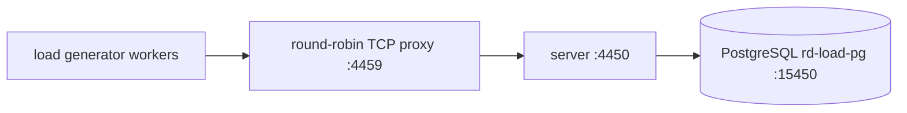
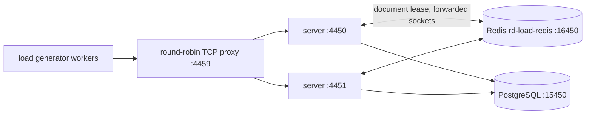

# RealtimeDocs load-test report

This is an engineering report of what was measured on one shared development host with the harness in `tests/load`. Numbers are measurements of that host, over loopback, from one source IP. Targets are never presented as results. Everything that was not run is listed under "NOT RUN".

## 1. Purpose and objectives

The owner's engineering objectives and the status after this test round:

| Objective                                                      | Measured                                                                                                                                                                                                                                                                                                                               | Met?                                                                             |
| -------------------------------------------------------------- | -------------------------------------------------------------------------------------------------------------------------------------------------------------------------------------------------------------------------------------------------------------------------------------------------------------------------------------- | -------------------------------------------------------------------------------- |
| 1,000 concurrent connected users                               | 1,000 of 1,000 sockets authenticated, synced and held for 120 s on topology A (1 instance) and C (2 instances + Redis); 0 lost during the hold                                                                                                                                                                                         | Met (controlled, loopback)                                                       |
| >= 99.9 % successful connection establishment, controlled test | 1,000 / 1,000 first-attempt successes on A and on C (100 %). A zero-failure sample of 1,000 only bounds the failure rate below about 0.3 % at 95 % confidence, so 99.9 % is consistent with this result but not statistically proven by it                                                                                             | Met in this test; sample too small to prove 99.9 %                               |
| API p95 < 300 ms                                               | Steady state: server-side p95 of all `/api/*` requests <= 25 ms histogram bucket; client-observed ticket request p95 4-6 ms. During a 1,000-client simultaneous reconnect storm the ticket endpoint's client-observed p95 was 369 ms on A (single instance, pool 10) and 252 ms on C                                                   | Met in steady state; **not met** in the single-instance reconnect storm (369 ms) |
| Collaboration delivery p95 < 250 ms, same region               | Edit to remote apply p95 1.8-2.6 ms at 1,000 edits/s (loopback, no network latency, so this bounds only server and client CPU cost)                                                                                                                                                                                                    | Met on loopback; real network latency is not included                            |
| Reconnection p95 < 5 s after a single instance restart         | Single instance restarted with 5 s deliberate downtime: p95 11.1 s (the outage is part of it). Two instances, one restarted, other healthy: p95 10.9 s (instance 1) and 10.5 s (instance 2), p50 5.5 s / 3.8 s. After a mass socket drop with all servers up (reconnect storm) p95 0.89 s (A) and 0.81 s (C)                           | **Not met** for the restart cases, see finding F1                                |
| Zero loss of acknowledged updates in controlled failure tests  | Every marker that received `saved` was found in the server's exported document in all runs: 0 missing of 195,330 (A, 250x4), 135,210 (C, 250x4), 195,300 (A, 100x10), 105,152 (C, 100x10), 26,294 (A restart), 40,489 (C rolling restart), 32,240 (Redis restart), 36,043 (10 s database pause)                                        | Met for the failure modes run                                                    |
| No unbounded memory growth in a one-hour soak                  | 12-minute run only (not 60): RSS rose from 330 MB to 401 MB while heap used oscillated between 130 and 196 MB with no clear trend (GC sawtooth); RSS slope 5.3 MB/min over the whole run, 12.1 MB/min after minute 10 (2 minutes of data, not meaningful). No visible flattening within 12 minutes                                     | **Not demonstrated**: needs a 60-minute run                                      |
| No single user able to starve others                           | Paste-burst scenario (5) was **not run** (time). Partial evidence only: per-socket frame budget and the 429 limits behaved as designed in scenarios 8 and 7-smoke                                                                                                                                                                      | **Not demonstrated**                                                             |
| Backpressure instead of crashes                                | Database paused 10 s under 400 typists: no crash, 2,121 `save-error storage_unavailable` (retrying) messages, persist queue peaked at 102,828 bytes (cap 16 MiB), all edits acknowledged after resume. API key limit (600/min) returned 600 x 429 with `Retry-After` and no errors. 20 MiB document was accepted (no hard cap, see F3) | Met for the cases run                                                            |

## 2. Host, environment and caveats

- Host: Linux 7.0.0 arm64 (NVIDIA), 20 cores, about 125 GB RAM, Node v24.22.2. The host also runs production RealtimeDocs and unrelated services; its 1-minute load average before runs was 3-5 and **peaked at 25.8 (A, 250x4 typing, run with 8 generator workers), 21.6 (A, 100x10, connect ramp), 21.4 and 18.9 on C** during connect surges. This exceeds the 18 limit given for the test; after the coordinator's note all later runs used 4 generator workers (the guard in `tests/load/src/metrics.ts` aborts a scenario when load stays above 18 for over a minute; it never triggered). These peaks may include other tenants' work, and they mean timing numbers here are pessimistic rather than optimistic with respect to CPU contention.
- Loopback networking only: no real latency, no TLS, no packet loss. One source IP (127.0.0.1) for all users.
- Server under test: the built bundle (`apps/server` esbuild output) copied to `tests/load/.stage/server`. **Bundle build times:** A-s1, A-s2, A-s3 ran against a bundle staged at about 2026-11-12T02:12Z; every other run against a bundle re-staged at **2026-11-12T02:46:44Z** (after the lead's security fixes in cluster routing bounds, metrics token check and history diff). No commit hash exists (uncommitted working tree).
- Containers: PostgreSQL `postgres:17.11-alpine` as `rd-load-pg`, Redis `redis:8.8.3` (`--save "" --appendonly no`) as `rd-load-redis`. No CPU or memory limits were set on either container; PostgreSQL ran with image defaults (max_connections 100, shared_buffers 128 MB, fsync on) on the host's normal disk. Servers ran as plain Node processes, not containers.
- Database: fresh database per run, 4 migrations applied by the bundle. `DB_POOL_MAX` 10 (default) on all runs reported here (topology B, a tuned pool, was **not run**).
- Rate limits: per-IP limits were raised because all users share 127.0.0.1: `RATE_API_PER_MINUTE`, `RATE_LOGIN_PER_IP`, `RATE_SHARE_EXCHANGE_PER_IP`, `RATE_SHARE_EXCHANGE_PER_GRANT`, `RATE_INVITE_PER_IP`, `RATE_SIGNUP_PER_IP`, `RATE_DESKTOP_REDEEM_PER_IP`, `RATE_DOWNLOAD_PER_IP`, `RATE_WS_UPGRADE_PER_MINUTE` (values in `src/stack.ts`, `RAISED_LIMITS`). Left at default: `RATE_COLLAB_TICKET_PER_MINUTE` (120, per session), `RATE_UPLOAD_PER_MINUTE` (240, per session), `RATE_API_KEY_PER_MINUTE` (600, per key), `COLLAB_FRAME_BURST` / `COLLAB_FRAMES_PER_SECOND`, `HISTORY_ENABLED=true`. `COLLAB_MAX_CONNECTIONS=5000`, `LOG_LEVEL=info`, `CLEANUP_INTERVAL_MINUTES=0`.
- Load generator: 8 (A-s1..s3) or 4 (all others) Node worker processes, one document's clients always in one worker. Generator CPU was 8-17 % per worker and event-loop lag p99 about 11 ms, so the generator was not the bottleneck at 1,000 edits/s.

## 3. Topologies



Topology A (and B with a larger pool): one instance. Topology C:



The proxy round-robins per TCP connection, so a client may reach the instance that does not own its document; the instances then forward the socket internally.

## 4. Dataset and client model

Each simulated user holds its own share-link guest session (EDITOR link, `POST /api/share/exchange`), requests a single-use ticket, and connects with the real Hocuspocus provider. Documents start empty; each user owns one paragraph and appends an 8-character marker per edit (one Yjs transaction, then a `mark`). Typing scenarios: 1 edit/s per user unless stated. Edit to remote apply is measured in the generator between a sender and a sampled receiver of the same document in the same process. Ack latency is edit to `saved`. Connect time is ticket request to synced plus `hello` acknowledged. Reconnect is capped exponential backoff, base 400 ms, factor 2, equal jitter, new ticket each time (same as `packages/editor/src/collab/backoff.ts`).

## 5. Results

Server CPU % is of one core (Node is single-threaded for this work). Latencies in milliseconds. "persist" is the server-side histogram of durable-log writes.

### 5.1 Scenario 1, 1,000 concurrent sockets (250 docs x 4, ramp 60 s, hold 120 s, presence on)

| Topology | Attempted | Established first try | Lost during hold | Connect p50 / p95 / p99 / max (ms) | Server CPU avg during ramp                        | RSS max        |
| -------- | --------: | --------------------: | ---------------: | ---------------------------------- | ------------------------------------------------- | -------------- |
| A        |     1,000 |         1,000 (100 %) |                0 | 29.4 / 42.5 / 53.4 / 113 (n=1000)  | 14.6 %                                            | 394 MB         |
| C        |     1,000 |         1,000 (100 %) |                0 | 32.1 / 43.7 / 52.8 / 97.8          | 9 % and 11 % (two instances, 536 and 464 sockets) | 366 and 361 MB |

Presence during the hold (every client updating its cursor every 5 s): awareness update to remote apply p50 / p95 / max: A 89 / 169 / 186 ms, C 49 / 75 / 98 ms (n=23,003 and 23,001). DB pool waiting max 3 on A. Error breakdown: none.

### 5.2 Scenario 2, 250 documents x 4 users typing, 1 edit/s each (1,000 edits/s), 180 s (C: 120 s)

A:

| metric (ms) |      n | p50 | p95 |  p99 |   max |
| ----------- | -----: | --: | --: | ---: | ----: |
| remote      | 180002 | 0.8 | 2.6 |  5.3 | 108.3 |
| ack         | 180001 | 4.3 | 8.6 | 15.2 | 121.7 |

| server | CPU avg % | CPU max % | RSS max MB | ws max | pool waiting max | loop lag p99 max ms | queue max B |
| ------ | --------: | --------: | ---------: | -----: | ---------------: | ------------------: | ----------: |
| :4450  |        52 |        70 |        505 |   1000 |               23 |                  26 |        1004 |

Achieved 1000 edits/s of 1000 target; generator CPU per worker 8/8/8/8/8/8/8/8 %, generator event-loop lag p99 11 ms; host load1 max 25.8; persist (server-side, per append): append mean 3.8 ms p95<=10; compact mean 5.5 ms p95<=25; verification: {"docs": 250, "checked": 195330, "missing": 0, "missingSamples": [], "unackedAtEnd": 0, "exportErrors": 0}.

C:

| metric (ms) |      n | p50 | p95 |  p99 |  max |
| ----------- | -----: | --: | --: | ---: | ---: |
| remote      | 120016 | 0.7 | 2.1 |  3.9 | 17.8 |
| ack         | 120016 | 4.0 | 7.2 | 10.2 | 29.3 |

| server | CPU avg % | CPU max % | RSS max MB | ws max | pool waiting max | loop lag p99 max ms | queue max B |
| ------ | --------: | --------: | ---------: | -----: | ---------------: | ------------------: | ----------: |
| :4450  |        35 |        49 |        335 |    484 |                0 |                  22 |         112 |
| :4451  |        35 |        51 |        346 |    516 |                0 |                  22 |         112 |

Achieved 1000.1 edits/s of 1000 target; generator CPU per worker 15/15/15/15 %, generator event-loop lag p99 11 ms; host load1 max 15.0; persist (server-side, per append): append mean 3.4 ms p95<=10; compact mean 3.5 ms p95<=10; verification: {"docs": 250, "checked": 135210, "missing": 0, "missingSamples": [], "unackedAtEnd": 0, "exportErrors": 0}.

At 1,000 edits/s one server core is about 52-56 % busy (A); with two instances each is about 35-41 %. The persist path writes one durable-log row per update (about 3 ms mean per append, server side). The pool of 10 was briefly saturated (23 waiting at the peak in the A-s2 run, which also had the 25.8 host load). The sustainable rate above 1,000 edits/s was **not measured** (scenario 2b not run).

### 5.3 Scenario 3, 100 documents x 10 users typing, 1 edit/s each, 180 s (C: 90 s)

A:

| metric (ms) |      n | p50 | p95 | p99 |  max |
| ----------- | -----: | --: | --: | --: | ---: |
| remote      | 180006 | 0.8 | 2.0 | 3.0 | 25.2 |
| ack         | 180005 | 3.8 | 6.0 | 8.0 | 38.8 |

| server | CPU avg % | CPU max % | RSS max MB | ws max | pool waiting max | loop lag p99 max ms | queue max B |
| ------ | --------: | --------: | ---------: | -----: | ---------------: | ------------------: | ----------: |
| :4450  |        56 |        60 |        451 |   1000 |                0 |                  22 |         168 |

Achieved 1000 edits/s of 1000 target; generator CPU per worker 9/8/9/9/8/8/8/8 %, generator event-loop lag p99 11 ms; host load1 max 10.3; persist (server-side, per append): append mean 3.0 ms p95<=5; compact mean 3.8 ms p95<=10; verification: {"docs": 100, "checked": 195300, "missing": 0, "missingSamples": [], "unackedAtEnd": 0, "exportErrors": 0}.

C:

| metric (ms) |     n | p50 | p95 | p99 |  max |
| ----------- | ----: | --: | --: | --: | ---: |
| remote      | 90008 | 0.8 | 1.8 | 2.5 |  7.3 |
| ack         | 90008 | 3.8 | 5.7 | 7.7 | 21.9 |

| server | CPU avg % | CPU max % | RSS max MB | ws max | pool waiting max | loop lag p99 max ms | queue max B |
| ------ | --------: | --------: | ---------: | -----: | ---------------: | ------------------: | ----------: |
| :4450  |        41 |        45 |        336 |    530 |                0 |                  21 |         112 |
| :4451  |        39 |        42 |        347 |    470 |                0 |                  21 |         168 |

Achieved 1000.1 edits/s of 1000 target; generator CPU per worker 16/17/17/17 %, generator event-loop lag p99 11 ms; host load1 max 7.4; persist (server-side, per append): append mean 3.0 ms p95<=5; compact mean 3.5 ms p95<=10; verification: {"docs": 100, "checked": 105152, "missing": 0, "missingSamples": [], "unackedAtEnd": 0, "exportErrors": 0}.

### 5.4 Scenario 6, presence updates (A): 100 docs x 4 = 400 clients at 5 awareness updates/s (2,000/s), 90 s

Awareness update to remote apply (n=180,000): p50 5 / p95 33 / p99 42 / max 55 ms. Server CPU avg 32 %, max 42 %, event-loop lag p99 43 ms, RSS 428 MB.

### 5.5 Scenario 8, session-creation API (A): 20 requests/s for 60 s, 30 % idempotent replays, one API key, default `RATE_API_KEY_PER_MINUTE` (600)

1,200 requests sent (20.02/s achieved). 434 creates (201) and 166 replays (201, all 166 carried `Idempotency-Replayed: true`); 418 creates and 182 replays were answered 429, and all 600 of the 429 responses carried `Retry-After`. No 5xx and no network errors. Create latency (successful) p50 11.8 / p95 17.1 / p99 22.7 ms; replay p50 3.7 / p95 4.9 ms. So 20 req/s from one key is above the default limit (10 req/s sustained); the limiter works as backpressure. A run with a higher `RATE_API_KEY_PER_MINUTE` or several keys was not made.

### 5.6 Scenario 10, restart (A: single instance; C: rolling restart, instance 1 then 2; 400 clients typing 1 edit/s; SIGTERM, 5 s down, start)

| Run                  | Shutdown (SIGTERM to exit) | Start to healthy | Reconnect (loss to synced+hello), p50 / p95 / max | Client errors during                                                                                        | Acked edits checked / missing |
| -------------------- | -------------------------- | ---------------- | ------------------------------------------------- | ----------------------------------------------------------------------------------------------------------- | ----------------------------- |
| A, the only instance | 178 ms                     | 527 ms           | 9,297 / 11,100 / 11,868 ms (n=400)                | 400 closes `4503 server_shutdown`; 1,599 failed ticket requests (`ECONNRESET`, `UND_ERR_SOCKET`) while down | 26,294 / 0                    |
| C, instance 1        | 101 ms                     | 364 ms           | 5,523 / 10,865 / 11,515 ms (n=254)                | 254 `4503 server_shutdown`, 609 `1006` closes, 13 ticket errors                                             | 40,489 / 0 (whole run)        |
| C, instance 2        | 151 ms                     | 527 ms           | 3,810 / 10,478 / 11,372 ms (n=398)                | 398 `4503`, 793 `1006`, 163 ticket errors                                                                   | (same run)                    |

In the A row 5.5 s of the reconnect time is the deliberate outage; the clients' backoff has grown to seconds by the time the server is back, so the remaining time is largely waiting out the backoff, not server readiness. Edits typed while disconnected were kept locally and acknowledged after `hello` (ack-offline p50 4.6 s on A, 4.1 s on C). See F1 for the C numbers.

### 5.7 Scenario 11, Redis restart during typing (C, 400 clients, 1 edit/s)

`docker restart rd-load-redis` took 381 ms. Readiness probes every 250 ms on both instances: 398 probes, 2 answered 503 (one per instance, at about 384 ms after the restart), none after. Clients saw no closes and no errors; ack p95 5.0 ms and remote p95 1.2 ms over the window. Server logs show `redis connection error` and an ioredis "enableOfflineQueue" warning on one instance at the restart. 32,240 acknowledged edits checked, 0 missing.

### 5.8 Scenario 12, database paused for 10 s under typing (A, 400 clients, 1 edit/s)

| Metric                                   | Value                                                                                                                       |
| ---------------------------------------- | --------------------------------------------------------------------------------------------------------------------------- |
| Clients saw                              | 2,121 `save-error` with code `storage_unavailable` (retrying), 360 `persistence degraded` and 360 `persistence ok` messages |
| Ack latency during the window (n=24,025) | p50 3.4 ms, p95 7,100 ms, p99 9,515 ms, max 10,040 ms (the edits made during the pause were acknowledged on resume)         |
| Remote apply                             | unaffected: p95 1.0 ms (live collaboration continued from memory)                                                           |
| Persist queue                            | peak 102,828 bytes (cap 16 MiB); DB pool waiting max 99, average 13.6                                                       |
| Crash / disconnect                       | none; quiesce reached 0 unacknowledged; 36,043 acknowledged edits checked, 0 missing                                        |

### 5.9 Scenario 13, reconnect storm (1,000 clients; the proxy destroys all proxied sockets at once)

| Topology | Time until 99 % synced | Until 100 % | Reconnect p50 / p95 / max (ms) | Ticket request client p50 / p95 / max (ms) | Server ticket endpoint                      | Close codes    |
| -------- | ---------------------- | ----------- | ------------------------------ | ------------------------------------------ | ------------------------------------------- | -------------- |
| A        | 1,507 ms               | 1,507 ms    | 813 / 894 / 1,475              | 190 / 369 / 1,049                          | mean 137 ms, p95 <= 250 ms (1,000 requests) | 1,000 x `1006` |
| C        | 1,012 ms               | 1,012 ms    | 679 / 815 / 843                | 143 / 252 / 255                            | mean 95-113 ms, p95 <= 250 ms               | 1,000 x `1006` |

Server CPU peaked at 77 % (A) and 97-115 % average per instance on C during the storm window (resync of 1,000 sockets at once). **Rate limits with defaults were not run in this round** (NOT RUN). By reading the code: `RATE_WS_UPGRADE_PER_MINUTE` defaults to 120 per source IP, so from one address (this test host, or an office behind NAT) at most 120 WebSocket upgrades per minute are accepted; with 1,000 users behind one NAT reconnecting at once, about 880 are closed with the rate-limited code and must retry with backoff, and `RATE_API_PER_MINUTE` (1,200 per IP per minute) covers ticket requests too. This is an inference from the configuration, not a measurement.

### 5.10 Scenario 14, revoked and expired links (C; 200 guests on 50 revoked links, 100 guests on 25 expiring links)

| Check                                                                                 | Result                                                                                                                                                                       |
| ------------------------------------------------------------------------------------- | ---------------------------------------------------------------------------------------------------------------------------------------------------------------------------- |
| Revoke 50 links through instance 2 (API answered 200 x 50, 120 ms for the batch)      | all 200 sockets closed with `4403 access_revoked`; revoke request to socket close p50 105 ms, p95 143 ms, max 145 ms; 0 still open (sockets were spread over both instances) |
| New ticket for a revoked link with an existing session                                | 200 of 200 answered 410                                                                                                                                                      |
| New share exchange for a revoked link                                                 | 20 of 20 answered 410                                                                                                                                                        |
| Expiring links (expiry 150 s after creation), default `COLLAB_SWEEP_INTERVAL_SECONDS` | all 100 sockets closed 57-108 ms after the expiry instant (p50 79, p95 105); exchange after expiry answered 410                                                              |

### 5.11 Scenario 15, large documents (A, one seeding editor, 100 paragraphs of 1,000 characters per update, default `LIMIT_MAX_DOCUMENT_STATE_BYTES` = 8 MiB)

| Yjs state               | Seed time | Fresh client time to synced (5 opens: min-max) | Server RSS before seed / after seed / after probes |
| ----------------------- | --------- | ---------------------------------------------- | -------------------------------------------------- |
| 1.09 MiB (1,144,025 B)  | 0.16 s    | 49-71 ms                                       | 344 / 360 / 352 MB                                 |
| 5.08 MiB (5,328,347 B)  | 1.0 s     | 67-167 ms                                      | 352 / 391 / 457 MB                                 |
| 20.0 MiB (21,018,348 B) | 8.8 s     | 272-454 ms                                     | 457 / 449 / 554 MB                                 |

Nothing was rejected, including the 20 MiB document: the "soft limit" only logs a warning at compaction (F3). The largest single update the seeding client sent was about 100 KB; the 4 MiB message limit (`LIMIT_MAX_COLLAB_MESSAGE_BYTES`) was not exercised (the 200 KB / table paste scenario was not run).

### 5.12 Scenario 16, soak (A, 250 docs x 4 users, 0.2 edits/s each = 200 edits/s, ran **12 minutes of the 60 requested**)

| Window (min) | remote p95 ms | ack p95 ms | reconnects | server RSS MB | errors |
| ------------ | ------------: | ---------: | ---------: | ------------- | ------ |
| 5            |           1.2 |        4.9 |          0 | [362.1]       | none   |
| 10           |           1.0 |        4.5 |          0 | [384.1]       | none   |
| 12           |           1.0 |        4.5 |          0 | [401.6]       | none   |

RSS slope (bytes/min), least squares over server `/metrics` samples every 5 s: after minute 10: 12071498; second half: 6482510; whole run: 5269550. Heap used slope after minute 10: -871425; second half: -1047422. RSS (MB) at minutes: {'min5': 362.1, 'min10': 384.1}. Heap used (MB): {'min5': 150.7, 'min10': 147.9}.

Verification: {"docs": 250, "checked": 144019, "missing": 0, "missingSamples": [], "unackedAtEnd": 0, "exportErrors": 0}.

## 6. Bottlenecks and findings

**F1. Reconnect after a graceful instance restart is slow even with a healthy peer (objective not met).** On topology C, restarting one instance (down 5 s, 0.4-0.5 s to healthy) gave reconnect p95 10.9 s / 10.5 s, p50 5.5 s / 3.8 s, with 609 and 793 `1006` abnormal closes and 163 failed ticket requests, although the other instance was healthy and `shutdownMs` was about 100-150 ms. The tail sits near the default lease TTL (`CLUSTER_LEASE_TTL_SECONDS` = 10) plus client backoff, which suggests documents owned by the stopped instance (or sockets forwarded to it) are not served by the peer immediately even though `Cluster.releaseAll` exists. This is a hypothesis; the logs at `warn` level do not show why and no per-attempt trace was taken. Evidence: `results/C-resilience/s10.json` and `s10.md`. For the single-instance case the dominant factor is the client backoff: a 5.5 s outage with a 400 ms/x2 backoff makes the first retry after recovery land up to several seconds late. Recommendation for the lead: find out what the new owner waits for after a clean SIGTERM (lease release, forward error handling); consider a shorter first backoff cap for the `shutdown` close code (4503) or retry the old instance promptly.

**F2. Thundering ticket requests.** 1,000 clients requesting tickets in the same second pushed the ticket endpoint to mean 137 ms / p95 250 ms (bucket) on a single instance with pool 10, versus about 3 ms in steady state; client-observed p95 369 ms exceeds the 300 ms objective. Tuned pool (topology B) was not measured, so it is not known whether `DB_POOL_MAX` fixes it.

**F3. `LIMIT_MAX_DOCUMENT_STATE_BYTES` is not enforced.** A 21 MB state was accepted and served; `collab/server.ts` only logs `document state exceeds the configured soft limit` at compaction. If a hard cap is intended, there is none; one editor can grow a document and every opener pays (fresh sync 270-450 ms and about 100 MB of extra server RSS at 20 MiB).

**F4. Database stall.** During a 10 s pause the pool had 99 waiters (average 13.6), the queue stayed bounded, and recovery was clean. Edit acknowledgement took up to 10 s, as designed. No defect, but `readiness` behaviour during the pause was not recorded.

**F5. Host contention.** The 1,000 edits/s run reached host load 25.8 with 8 generator workers, partly other tenants. Server CPU for the run was 52 % of one core, so the server is not the cause.

Changes made as a result: none to the server (out of lane). Harness-only changes are in `tests/load`. Recommendations above are for the lead.

### Lead's follow-up after this report (2026-11-12)

Work done on findings F1 and F3 after the runs above. Scenario numbers refer to section 5.

- **F1, what was checked on the server.** An integration test now covers the handover directly
  (`apps/server/test/integration/cluster.test.ts`, "hands many documents over quickly when their owner
  stops while clients are connected"): twenty documents owned by one instance, each with editors that
  entered through both instances; the owner gets `SIGTERM`; every editor reconnects through the other
  instance without waiting for the owner to exit. With a lease of 30 s, all twenty documents were open
  again, with their acknowledged content, in under 5 s (the test's limit). The stopped instance gives its
  leases back; the lease time is not what clients wait for after a graceful stop. A race was found while
  reading the code and closed: a lease renewal still in flight during the stop could take back a lease
  that had just been released.
- **F1, what was changed.** The reconnect backoff of the client grows by 1.6 per attempt instead of 2
  (`packages/editor/src/collab/backoff.ts`; base 400 ms, cap 30 s and jitter unchanged). The harness
  client was changed the same way.
- **F1, measured again.** Scenario 10 on topology C with the new backoff and the current server
  (`results/C-s10-backoff16`, 400 clients, 4 generator workers, host load at most 10.6):

  | Restart of | Clients that reconnected | Reconnect p50 |   p95 |   max | Before (p50 / p95) |
  | ---------- | -----------------------: | ------------: | ----: | ----: | ------------------ |
  | instance 1 |                      276 |         2.8 s | 8.9 s | 9.5 s | 5.5 s / 10.9 s     |
  | instance 2 |                      398 |         5.5 s | 8.7 s | 9.5 s | 3.8 s / 10.5 s     |

  All 400 clients were connected at the end of each restart, and no acknowledged marker was missing.
  **The objective (p95 below 5 s) is still not met in this harness.** Each reconnecting client needed
  about three ticket requests, and most failed attempts ended as abnormal closes (`1006`) or reset HTTP
  connections at the harness's TCP proxy during the five seconds the instance was deliberately kept
  down. Why attempts through the proxy failed while the other instance was healthy was **not
  isolated**; the server-side test above does not reproduce it. A run behind a balancer that takes a
  stopped instance out of rotation (nginx as in `deploy/scale/`, or one with active health checks) is
  the measurement that is still missing.

- **F3, not changed.** `LIMIT_MAX_DOCUMENT_STATE_BYTES` stays a warning, not a refusal. Refusing edits
  to a document that has grown past the limit would lock people out of their own content, and stopping
  growth cleanly needs a client-side message that does not exist yet. It is listed in
  [known-limitations.md](known-limitations.md). What bounds a single edit is the frame size
  (`LIMIT_MAX_COLLAB_MESSAGE_BYTES`) and the write queue (`COLLAB_MAX_QUEUE_BYTES`); what bounds a paste
  in the editor is 2,000,000 characters of HTML and 1,000,000 of text.
- **F2, not changed and not measured further.** `DB_POOL_MAX` above 10 was not tried.

## 7. Limits tested

- Largest document opened: 20.0 MiB Yjs state (21,018,348 B, 20,102 paragraphs): opened in 272-454 ms.
- Largest paste: **not tested** (scenario 5 not run). Largest single update sent: about 100 KB (seeding).
- Most editors in one document: **10 per document** (scenario 3, 100 x 10). Scenario 4 (10/25/50 in one hot document) was not run.
- Most concurrent sockets: 1,000 per instance (A) and 1,000 across two instances (C). The cap was raised to 5,000; behaviour at the default cap (1,000) or above 1,000 was not tested.
- Highest edit rate: 1,000 edits/s (1 edit/s x 1,000 users), sustained 90-180 s without queueing (persist queue peak 1 KB).

## 8. NOT RUN, with reasons

| Item                                                                          | Reason                                                                                                                                           |
| ----------------------------------------------------------------------------- | ------------------------------------------------------------------------------------------------------------------------------------------------ |
| Topology B (tuned pool) for any scenario; HISTORY_ENABLED=false comparison    | Time budget (about 75 minutes after the lead's note)                                                                                             |
| Scenario 2b (sustainable rate above 1,000 edits/s)                            | Time                                                                                                                                             |
| Scenario 4 (hot document 10/25/50)                                            | Time; a 3/6-editor smoke run worked but is not reported                                                                                          |
| Scenario 5 (paste bursts, starvation check)                                   | Time; smoke only                                                                                                                                 |
| Scenario 7 (50 concurrent uploaders; default upload limit)                    | Time; smoke run on an earlier build showed 937 x 201 and 316 x 429 with `Retry-After` for 4 sessions x 300 uploads, not a reportable measurement |
| Scenario 9 (history reads)                                                    | Time                                                                                                                                             |
| Scenario 13 with default `RATE_WS_UPGRADE_PER_MINUTE` / `RATE_API_PER_MINUTE` | Time (needs a ~11 minute ramp); analysis above is inferred from code                                                                             |
| Scenario 16 for the full 60 minutes                                           | Run shortened to 12 minutes (time budget)                                                                                                        |
| Topology B/C for scenarios 12, 15, 11 on A, 14 on A                           | Time                                                                                                                                             |

## 9. Reproduce

```bash
. scripts/dev-env.sh
cd tests/load
node --import tsx src/stack.ts stage                          # build and copy the bundle
node --import tsx src/run.ts s1 --topology A --workers 4 --out A-s1
node --import tsx src/run.ts s2 --topology C --workers 4 --duration 120 --out C-s2
node --import tsx src/run.ts s13,s10,s11,s14 --topology C --workers 4 --out C-resilience
node --import tsx src/run.ts s12,s15 --topology A --workers 4 --out A-s12-s15
node --import tsx src/run.ts s16 --topology A --workers 4 --minutes 60 --out A-s16
```

`tests/load/suite.sh phase3` is the exact sequence of this round. Raw results: `tests/load/results/<run>/` (`<scenario>.json`, `.md`, `metrics.json`, `environment.json`, server warning logs). Harness description: `tests/load/README.md`.
