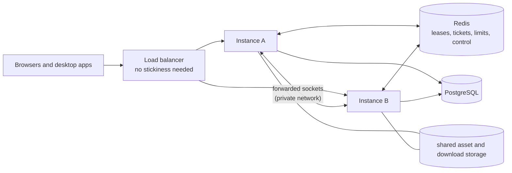

# Scaling guide

How RealtimeDocs runs on more than one server instance, what that needs, and what was verified.
Measured capacity is in [load-test-report.md](load-test-report.md); the reasons for the design are in
[decisions.md](decisions.md).

## One instance (the default)

Without `REDIS_URL` the server is exactly one process: documents, tickets, rate-limit counters and the
list of live connections are in its memory. This is how the public deployment runs today.

## Several instances



Set on **every** instance:

| Setting                                           | Value                                                                                                                                                 |
| ------------------------------------------------- | ----------------------------------------------------------------------------------------------------------------------------------------------------- |
| `REDIS_URL`                                       | `redis://…` or `rediss://…`. Turns coordination on.                                                                                                   |
| `CLUSTER_INTERNAL_URL`                            | The address **other instances** reach this one at, for example `http://server2:4310`. Default: `http://<hostname>:<RD_PORT>`. Never a public address. |
| `CLUSTER_LEASE_TTL_SECONDS`                       | Default 10. After an instance dies without saying goodbye, its documents can be taken over this many seconds later.                                   |
| `SHUTDOWN_DRAIN_SECONDS`                          | Default 0. Seconds between "not ready" and closing connections on a stop. Set it a little above the load balancer's health-check interval.            |
| `DATABASE_URL`, `SESSION_SECRET`, `PUBLIC_ORIGIN` | Identical on all instances. The instances authenticate forwarded sockets to each other with a key derived from `SESSION_SECRET`.                      |
| `ASSET_DIR`, `DOWNLOAD_DIR`                       | The same shared storage (one volume mounted in every instance, or a network file system).                                                             |

### What is coordinated

- **Document ownership.** One instance holds a document in memory and writes its log. The first instance
  that gets a socket for a document takes a lease in Redis and renews it while the document is in use.
  Another instance that gets a socket for the same document forwards it, frame for frame, to the owner.
  Everyone in a document is therefore in one room: edits, presence and "Saved" behave as on one instance.
- **Tickets.** A collaboration ticket issued by any instance is redeemed once, by whichever instance the
  socket reaches.
- **Revocation and restore.** Revoking a link, disabling an account, changing a role and restoring a
  version are announced to every instance; the one that holds the affected sockets closes or downgrades
  them. The periodic sweep (`COLLAB_SWEEP_INTERVAL_SECONDS`) remains as a second line.
- **Rate limits.** Counted in Redis, so a limit is the same whichever instance a request reaches. The
  per-address limit on new collaboration sockets (`RATE_WS_UPGRADE_PER_MINUTE`) stays per instance.
- **Background work.** The retention job and migrations take PostgreSQL advisory locks; webhook deliveries
  are claimed with `FOR UPDATE SKIP LOCKED`. Any number of instances may run them.

### What keeps data correct

The lease decides routing only. Correctness comes from the database: an update is committed as
`head_seq + 1` under a lock on the document row, and a writer whose idea of `head_seq` is stale is
refused, drops its copy of the document and closes its clients, which reconnect and are routed to the
owner. A client is told "Saved" only after its update is committed, and it keeps anything not yet
acknowledged and sends it again after a reconnect.

### Failure behaviour

| Event                              | What happens                                                                                                                                                                                                                |
| ---------------------------------- | --------------------------------------------------------------------------------------------------------------------------------------------------------------------------------------------------------------------------- |
| An instance is stopped (`SIGTERM`) | `/api/ready` answers 503 at once; after `SHUTDOWN_DRAIN_SECONDS` clients are told, logs are flushed, sockets closed, leases given back. Clients reconnect to another instance, which loads the documents from the database. |
| An instance is killed              | Its sockets drop. Its leases expire after `CLUSTER_LEASE_TTL_SECONDS`; until then reconnecting clients are refused and retry. Acknowledged edits are in the database.                                                       |
| Redis is unreachable               | Open documents keep working and saving. New collaboration connections cannot get a ticket and retry. `/api/ready` answers 503. Rate limits let requests through. When Redis returns, leases are taken again.                |
| PostgreSQL is unreachable          | As on one instance: edits queue up to `COLLAB_MAX_QUEUE_BYTES`, then documents stop accepting edits; nothing is acknowledged until it is committed.                                                                         |

### Load balancer

Any proxy that passes WebSocket upgrades. No stickiness. It should probe `/api/ready` (which checks
PostgreSQL, Redis and whether the instance is stopping) and stop sending new connections to an instance
that answers 503. `TRUST_PROXY` must equal the number of proxies in front of the application. An example
with nginx and two instances is in `deploy/scale/` (`docker-compose.scale.yml`, `nginx.conf`).

### Rolling deployment

1. Take a backup (`scripts/backup.sh`).
2. Database migrations of this product are additive, so the old version keeps working on the new schema.
   Start **one** new instance first: it applies the migrations under an advisory lock.
3. Replace the other instances one at a time. Each stop moves its documents to the remaining instances;
   clients reconnect within seconds (measured values: load-test report).
4. Roll back by starting the previous image; the schema does not have to go back.

### PostgreSQL connections

Each instance opens up to `DB_POOL_MAX` connections (default 10). A commit of a document takes one
connection for one statement, so the pool limits how many documents can commit at the same instant, not
how many users are connected. Raise `DB_POOL_MAX` when `rd_db_pool_waiting` is above zero for long
periods; keep `instances × DB_POOL_MAX` below PostgreSQL's `max_connections` (100 by default) with room
for backups and operators. A pooler such as PgBouncer is only needed beyond that; the server uses no
session state that transaction pooling would break except the advisory locks of the migration runner and
the retention job, which must connect directly.

### Object storage

Assets and desktop releases are files behind a small storage interface (`apps/server/src/assets/storage.ts`).
Several instances need the same directory. An S3-compatible implementation of that interface is not part
of this release.

## What was verified, and what was not

- Verified on this host with real processes (`apps/server/test/integration/cluster.test.ts`): two
  instances, one PostgreSQL, one Redis; editors on different instances in one room; a ticket from one
  instance redeemed on the other, once; revocation through one instance closing a socket that entered
  through the other; one rate-limit count for both; acknowledged edits after the owner stopped; saving
  during a Redis outage and recovery after it.
- Verified once as a running Compose stack (2026-11-12, project `rd-scale-trial`, its own ports, volumes
  and image tag, removed afterwards): the image built from this checkout, both instances, Redis with a
  password and the nginx balancer became healthy; sign-in, eight collaboration sockets through the
  balancer (four served by the owner directly, four forwarded to it by the other instance), edits
  visible to all eight, version history recorded. The first attempt sent every socket to one instance:
  nginx workers counted connections separately. The `zone` line in `nginx.conf` fixed that and the check
  was repeated.
- Stopping one of the two instances while requesting `/api/meta` four times a second through the
  balancer: 8 of 40 requests failed (2 seconds), because nginx waited for a connection to an instance
  that no longer existed. `proxy_connect_timeout 1s` was added afterwards. **That change was not
  measured.** Collaboration clients reconnect by themselves; plain API calls made in that window can fail
  and are retried by the web app's data layer where it retries.
- Load and failure measurements with many clients: [load-test-report.md](load-test-report.md).
- **Not verified:** instances on different hosts, a shared network file system, TLS between instances
  (the forwarded hop is plain HTTP on the private network, like the hop from the tunnel today), Redis
  Cluster or Sentinel, a balancer with active health checks.

## Trying it on this server without touching the live deployment

The base `docker-compose.yml` defaults to the live project's name, ports and image tag. A trial must
override all of them, in its own env file:

```sh
# trial.env: POSTGRES_PASSWORD, SESSION_SECRET, REDIS_PASSWORD (generated), and
#   PUBLIC_ORIGIN=http://127.0.0.1:4460  TRUST_PROXY=1
#   RD_PORT=4463  RD_DB_PORT=15463  RD_LB_PORT=4460
#   RD_IMAGE=rd-scale-trial-server:trial      <- otherwise the build replaces the live image tag
RD_COMPOSE_ENV_FILE=trial.env docker compose -p rd-scale-trial --env-file trial.env \
  -f docker-compose.yml -f deploy/scale/docker-compose.scale.yml up -d --build --wait
```

Remove it with the same command and `down -v`. `-v` is safe **only** because of `-p rd-scale-trial`; never
type it for the project `realtimedocs`.
